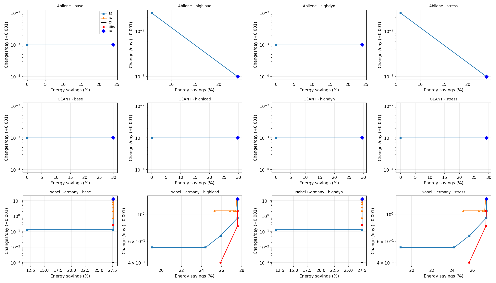
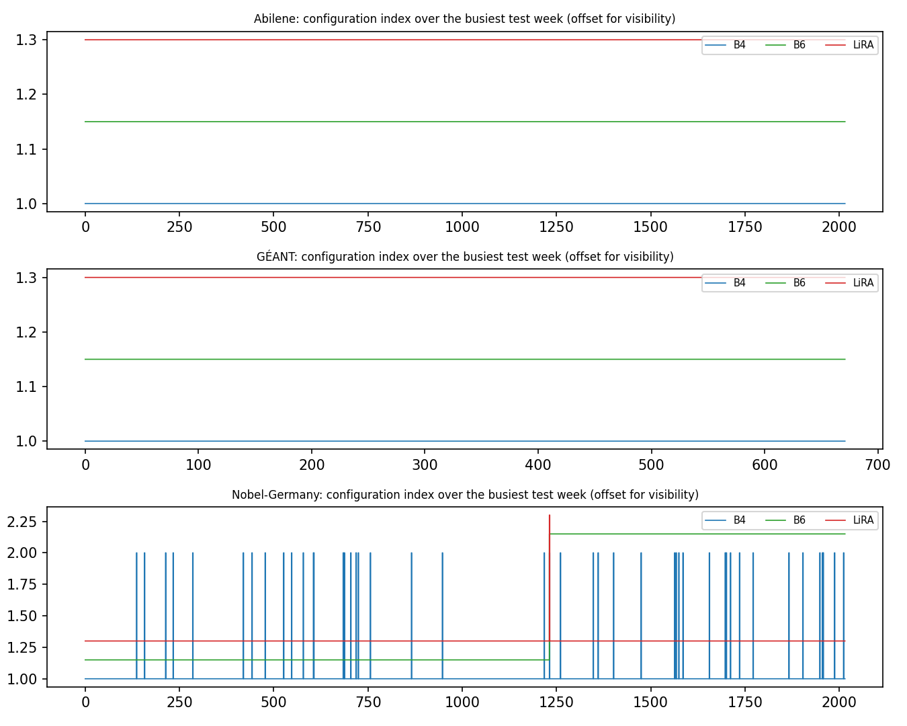

# Experimental results (measured)

All numbers below are produced by `experiments/run_main.py` and `experiments/run_extra.py` and read from the CSV files in this folder by `experiments/make_report.py`. Nothing is typed by hand.

## Environment

| item | value |
|---|---|
| python | 3.11.9 |
| os | Windows-10-10.0.26220-SP0 |
| cpu | 13th Gen Intel(R) Core(TM) i9-13900H (14 cores, 20 threads) |
| cores_logical | 20 |
| ram_bytes | 47.6 GB |
| gpu | not used |
| numpy | 2.3.5 |
| pandas | 2.3.3 |
| scipy | 1.17.1 |
| sklearn | 1.8.0 |
| xgboost | 3.2.0 |
| lightgbm | 4.7.0 |
| highspy | 1.15.1 |
| emulation | Ubuntu on WSL2 (Linux 6.18), Mininet 2.3.0, Open vSwitch 3.7.1, Python 3.14.4 |

## Data (Phase 2)

| topology      |   nodes |   links |   OD pairs | interval   |   intervals kept | start      | end        | dropped (gaps/outages)   | spikes removed   |   scale factor | type           |
|:--------------|--------:|--------:|-----------:|:-----------|-----------------:|:-----------|:-----------|:-------------------------|:-----------------|---------------:|:---------------|
| Abilene       |      12 |      15 |        132 | 5min       |            48108 | 2004-03-01 | 2004-09-10 | 7764                     | 0                |         0.1954 | real (SNDlib)  |
| GÉANT         |      22 |      36 |        462 | 15min      |            10784 | 2005-05-04 | 2005-08-31 | 676                      | 11               |         0.9671 | real (SNDlib)  |
| Nobel-Germany |      17 |      26 |        272 | 5min       |             8640 | 2004-03-01 | 2004-03-30 | n/a (synthetic)          | n/a              |         0.0606 | semi-synthetic |

## E1 Main comparison (test split; 5 seeds; mean ± 95% CI over seeds)

### Abilene — base scenario (λR=0.576, λW=23, K=32)

| method     | Savings S (%)   | Changes/day   | Link transitions/day   | MLU viol. (%)   | Total cost J   | Mean AF       | Median latency (ms)   |
|:-----------|:----------------|:--------------|:-----------------------|:----------------|:---------------|:--------------|:----------------------|
| B0         | 0.00            | 0.00          | 0.00                   | 0.000           | 12037.5        | 1.000         |                       |
| SNAP-exact | 23.98           | 0.19          | 0.77                   | 0.000           | 7236.6         | 0.867         |                       |
| B2-naive   | 23.95           | 0.00          | 0.00                   | 0.000           | 7230.4         | 0.867         | 0.433                 |
| B2-perfect | 23.95           | 0.00          | 0.00                   | 0.000           | 7230.4         | 0.867         | 0.414                 |
| B4         | 23.98 ± 0.00    | 0.02 ± 0.05   | 0.08 ± 0.21            | 0.000 ± 0.000   | 7227.7 ± 2.8   | 0.867 ± 0.000 | 0.989 ± 0.041         |
| B6         | 23.98 ± 0.00    | 0.00 ± 0.00   | 0.00 ± 0.00            | 0.000 ± 0.000   | 7226.7 ± 0.0   | 0.867 ± 0.000 | 0.989 ± 0.041         |
| B7         | 23.98 ± 0.00    | 0.02 ± 0.05   | 0.08 ± 0.21            | 0.000 ± 0.000   | 7227.7 ± 2.8   | 0.867 ± 0.000 | 0.989 ± 0.041         |
| LiRA       | 23.98 ± 0.00    | 0.00 ± 0.00   | 0.00 ± 0.00            | 0.000 ± 0.000   | 7226.7 ± 0.0   | 0.867 ± 0.000 | 0.008 ± 0.000         |
| O*         | 23.98           | 0.00          | 0.00                   | 0.000           | 7226.7         | 0.867         |                       |

LiRA vs B4: retention X = 100.00 ± 0.00 %; change reduction Y = undefined (B4 makes 0 configuration changes); transition reduction Z = undefined (B4 makes 0 transitions).

### Abilene — highload scenario (λR=0.576, λW=23, K=32)

| method     | Savings S (%)   | Changes/day   | Link transitions/day   | MLU viol. (%)   | Total cost J   | Mean AF       | Median latency (ms)   |
|:-----------|:----------------|:--------------|:-----------------------|:----------------|:---------------|:--------------|:----------------------|
| B0         | 0.00            | 0.00          | 0.00                   | 1.596           | 12043.9        | 1.000         |                       |
| SNAP-exact | 23.97           | 0.19          | 0.77                   | 0.000           | 7242.9         | 0.867         |                       |
| B2-naive   | 23.94           | 0.02          | 0.05                   | 0.000           | 7237.2         | 0.867         | 0.358                 |
| B2-perfect | 23.94           | 0.02          | 0.05                   | 0.000           | 7237.1         | 0.867         | 0.353                 |
| B4         | 23.97 ± 0.00    | 0.00 ± 0.00   | 0.00 ± 0.00            | 0.000 ± 0.000   | 7233.0 ± 0.0   | 0.867 ± 0.000 | 9.704 ± 14.128        |
| B6         | 23.97 ± 0.00    | 0.00 ± 0.00   | 0.00 ± 0.00            | 0.000 ± 0.000   | 7233.0 ± 0.0   | 0.867 ± 0.000 | 9.704 ± 14.128        |
| B7         | 23.97 ± 0.00    | 0.00 ± 0.00   | 0.00 ± 0.00            | 0.000 ± 0.000   | 7233.0 ± 0.0   | 0.867 ± 0.000 | 9.704 ± 14.128        |
| LiRA       | 23.97 ± 0.00    | 0.00 ± 0.00   | 0.00 ± 0.00            | 0.000 ± 0.000   | 7233.0 ± 0.0   | 0.867 ± 0.000 | 0.008 ± 0.001         |
| O*         | 23.97           | 0.00          | 0.00                   | 0.000           | 7233.0         | 0.867         |                       |

LiRA vs B4: retention X = 100.00 ± 0.00 %; change reduction Y = undefined (B4 makes 0 configuration changes); transition reduction Z = undefined (B4 makes 0 transitions).

### Abilene — highdyn scenario (λR=0.576, λW=23, K=32)

| method     | Savings S (%)   | Changes/day   | Link transitions/day   | MLU viol. (%)   | Total cost J   | Mean AF       | Median latency (ms)   |
|:-----------|:----------------|:--------------|:-----------------------|:----------------|:---------------|:--------------|:----------------------|
| B0         | 0.00            | 0.00          | 0.00                   | 0.000           | 12058.6        | 1.000         |                       |
| SNAP-exact | 23.94           | 0.19          | 0.77                   | 0.000           | 7257.6         | 0.867         |                       |
| B2-naive   | 23.85           | 0.00          | 0.00                   | 0.000           | 7258.7         | 0.867         | 0.348                 |
| B2-perfect | 23.85           | 0.00          | 0.00                   | 0.000           | 7258.7         | 0.867         | 0.421                 |
| B4         | 23.94 ± 0.00    | 0.02 ± 0.05   | 0.08 ± 0.21            | 0.000 ± 0.000   | 7248.7 ± 2.8   | 0.867 ± 0.000 | 1.499 ± 0.329         |
| B6         | 23.94 ± 0.00    | 0.00 ± 0.00   | 0.00 ± 0.00            | 0.000 ± 0.000   | 7247.7 ± 0.0   | 0.867 ± 0.000 | 1.499 ± 0.329         |
| B7         | 23.94 ± 0.00    | 0.02 ± 0.05   | 0.08 ± 0.21            | 0.000 ± 0.000   | 7248.7 ± 2.8   | 0.867 ± 0.000 | 1.499 ± 0.329         |
| LiRA       | 23.94 ± 0.00    | 0.00 ± 0.00   | 0.00 ± 0.00            | 0.000 ± 0.000   | 7247.7 ± 0.0   | 0.867 ± 0.000 | 0.008 ± 0.001         |
| O*         | 23.94           | 0.00          | 0.00                   | 0.000           | 7247.7         | 0.867         |                       |

LiRA vs B4: retention X = 100.00 ± 0.00 %; change reduction Y = undefined (B4 makes 0 configuration changes); transition reduction Z = undefined (B4 makes 0 transitions).

### Abilene — stress scenario (λR=0.576, λW=23, K=32)

| method     | Savings S (%)   | Changes/day   | Link transitions/day   | MLU viol. (%)   | Total cost J   | Mean AF       | Median latency (ms)   |
|:-----------|:----------------|:--------------|:-----------------------|:----------------|:---------------|:--------------|:----------------------|
| B0         | 0.00            | 0.00          | 0.00                   | 1.596           | 12077.6        | 1.000         |                       |
| SNAP-exact | 23.90           | 0.19          | 0.77                   | 0.000           | 7276.6         | 0.867         |                       |
| B2-naive   | 23.82           | 0.02          | 0.05                   | 0.000           | 7277.7         | 0.867         | 0.441                 |
| B2-perfect | 23.82           | 0.02          | 0.05                   | 0.000           | 7277.7         | 0.867         | 0.434                 |
| B4         | 23.90 ± 0.00    | 0.00 ± 0.00   | 0.00 ± 0.00            | 0.000 ± 0.000   | 7266.6 ± 0.0   | 0.867 ± 0.000 | 0.385 ± 0.175         |
| B6         | 23.90 ± 0.00    | 0.00 ± 0.00   | 0.00 ± 0.00            | 0.000 ± 0.000   | 7266.6 ± 0.0   | 0.867 ± 0.000 | 0.385 ± 0.175         |
| B7         | 23.90 ± 0.00    | 0.00 ± 0.00   | 0.00 ± 0.00            | 0.000 ± 0.000   | 7266.6 ± 0.0   | 0.867 ± 0.000 | 0.385 ± 0.175         |
| LiRA       | 23.90 ± 0.00    | 0.00 ± 0.00   | 0.00 ± 0.00            | 0.000 ± 0.000   | 7266.6 ± 0.0   | 0.867 ± 0.000 | 0.004 ± 0.003         |
| O*         | 23.90           | 0.00          | 0.00                   | 0.000           | 7266.6         | 0.867         |                       |

LiRA vs B4: retention X = 100.00 ± 0.00 %; change reduction Y = undefined (B4 makes 0 configuration changes); transition reduction Z = undefined (B4 makes 0 transitions).

### GÉANT — base scenario (λR=0.192, λW=7.68, K=32)

| method     | Savings S (%)   | Changes/day   | Link transitions/day   | MLU viol. (%)   | Total cost J   | Mean AF       | Median latency (ms)   |
|:-----------|:----------------|:--------------|:-----------------------|:----------------|:---------------|:--------------|:----------------------|
| B0         | 0.00            | 0.00          | 0.00                   | 0.000           | 2705.2         | 1.000         |                       |
| SNAP-exact | 29.85           | 0.00          | 0.00                   | 0.000           | 603.7          | 0.833         |                       |
| B2-naive   | 29.85           | 0.00          | 0.00                   | 0.000           | 603.7          | 0.833         | 0.432                 |
| B2-perfect | 29.85           | 0.00          | 0.00                   | 0.000           | 603.7          | 0.833         | 0.417                 |
| B4         | 29.85 ± 0.00    | 0.00 ± 0.00   | 0.00 ± 0.00            | 0.000 ± 0.000   | 603.7 ± 0.0    | 0.833 ± 0.000 | 1.599 ± 0.722         |
| B6         | 29.85 ± 0.00    | 0.00 ± 0.00   | 0.00 ± 0.00            | 0.000 ± 0.000   | 603.7 ± 0.0    | 0.833 ± 0.000 | 1.599 ± 0.722         |
| B7         | 29.85 ± 0.00    | 0.00 ± 0.00   | 0.00 ± 0.00            | 0.000 ± 0.000   | 603.7 ± 0.0    | 0.833 ± 0.000 | 1.599 ± 0.722         |
| LiRA       | 29.85 ± 0.00    | 0.00 ± 0.00   | 0.00 ± 0.00            | 0.000 ± 0.000   | 603.7 ± 0.0    | 0.833 ± 0.000 | 1.571 ± 0.735         |
| O*         | 29.85           | 0.00          | 0.00                   | 0.000           | 603.7          | 0.833         |                       |

LiRA vs B4: retention X = 100.00 ± 0.00 %; change reduction Y = undefined (B4 makes 0 configuration changes); transition reduction Z = undefined (B4 makes 0 transitions).

### GÉANT — highload scenario (λR=0.192, λW=7.68, K=32)

| method     | Savings S (%)   | Changes/day   | Link transitions/day   | MLU viol. (%)   | Total cost J   | Mean AF       | Median latency (ms)   |
|:-----------|:----------------|:--------------|:-----------------------|:----------------|:---------------|:--------------|:----------------------|
| B0         | 0.00            | 0.00          | 0.00                   | 0.000           | 2710.8         | 1.000         |                       |
| SNAP-exact | 29.75           | 0.00          | 0.00                   | 0.000           | 610.4          | 0.833         |                       |
| B2-naive   | 29.75           | 0.00          | 0.00                   | 0.000           | 610.4          | 0.833         | 0.358                 |
| B2-perfect | 29.75           | 0.00          | 0.00                   | 0.000           | 610.4          | 0.833         | 0.408                 |
| B4         | 29.75 ± 0.00    | 0.00 ± 0.00   | 0.00 ± 0.00            | 0.000 ± 0.000   | 610.4 ± 0.0    | 0.833 ± 0.000 | 0.735 ± 0.196         |
| B6         | 29.75 ± 0.00    | 0.00 ± 0.00   | 0.00 ± 0.00            | 0.000 ± 0.000   | 610.4 ± 0.0    | 0.833 ± 0.000 | 0.735 ± 0.196         |
| B7         | 29.75 ± 0.00    | 0.00 ± 0.00   | 0.00 ± 0.00            | 0.000 ± 0.000   | 610.4 ± 0.0    | 0.833 ± 0.000 | 0.735 ± 0.196         |
| LiRA       | 29.75 ± 0.00    | 0.00 ± 0.00   | 0.00 ± 0.00            | 0.000 ± 0.000   | 610.4 ± 0.0    | 0.833 ± 0.000 | 0.716 ± 0.080         |
| O*         | 29.75           | 0.00          | 0.00                   | 0.000           | 610.4          | 0.833         |                       |

LiRA vs B4: retention X = 100.00 ± 0.00 %; change reduction Y = undefined (B4 makes 0 configuration changes); transition reduction Z = undefined (B4 makes 0 transitions).

### GÉANT — highdyn scenario (λR=0.192, λW=7.68, K=32)

| method     | Savings S (%)   | Changes/day   | Link transitions/day   | MLU viol. (%)   | Total cost J   | Mean AF       | Median latency (ms)   |
|:-----------|:----------------|:--------------|:-----------------------|:----------------|:---------------|:--------------|:----------------------|
| B0         | 0.00            | 0.00          | 0.00                   | 0.000           | 2723.7         | 1.000         |                       |
| SNAP-exact | 29.54           | 0.00          | 0.00                   | 0.000           | 625.0          | 0.833         |                       |
| B2-naive   | 29.54           | 0.00          | 0.00                   | 0.000           | 625.0          | 0.833         | 0.368                 |
| B2-perfect | 29.54           | 0.00          | 0.00                   | 0.000           | 625.0          | 0.833         | 0.369                 |
| B4         | 29.54 ± 0.00    | 0.00 ± 0.00   | 0.00 ± 0.00            | 0.000 ± 0.000   | 625.0 ± 0.0    | 0.833 ± 0.000 | 0.766 ± 0.268         |
| B6         | 29.54 ± 0.00    | 0.00 ± 0.00   | 0.00 ± 0.00            | 0.000 ± 0.000   | 625.0 ± 0.0    | 0.833 ± 0.000 | 0.766 ± 0.268         |
| B7         | 29.54 ± 0.00    | 0.00 ± 0.00   | 0.00 ± 0.00            | 0.000 ± 0.000   | 625.0 ± 0.0    | 0.833 ± 0.000 | 0.766 ± 0.268         |
| LiRA       | 29.54 ± 0.00    | 0.00 ± 0.00   | 0.00 ± 0.00            | 0.000 ± 0.000   | 625.0 ± 0.0    | 0.833 ± 0.000 | 0.843 ± 0.137         |
| O*         | 29.54           | 0.00          | 0.00                   | 0.000           | 625.0          | 0.833         |                       |

LiRA vs B4: retention X = 100.00 ± 0.00 %; change reduction Y = undefined (B4 makes 0 configuration changes); transition reduction Z = undefined (B4 makes 0 transitions).

### GÉANT — stress scenario (λR=0.192, λW=7.68, K=32)

| method     | Savings S (%)   | Changes/day   | Link transitions/day   | MLU viol. (%)   | Total cost J   | Mean AF       | Median latency (ms)   |
|:-----------|:----------------|:--------------|:-----------------------|:----------------|:---------------|:--------------|:----------------------|
| B0         | 0.00            | 0.00          | 0.00                   | 0.000           | 2740.3         | 1.000         |                       |
| SNAP-exact | 29.24           | 0.00          | 0.00                   | 0.000           | 644.8          | 0.833         |                       |
| B2-naive   | 29.24           | 0.00          | 0.00                   | 0.000           | 644.8          | 0.833         | 0.538                 |
| B2-perfect | 29.24           | 0.00          | 0.00                   | 0.000           | 644.8          | 0.833         | 0.527                 |
| B4         | 29.24 ± 0.00    | 0.00 ± 0.00   | 0.00 ± 0.00            | 0.000 ± 0.000   | 644.8 ± 0.0    | 0.833 ± 0.000 | 1.501 ± 0.886         |
| B6         | 29.24 ± 0.00    | 0.00 ± 0.00   | 0.00 ± 0.00            | 0.000 ± 0.000   | 644.8 ± 0.0    | 0.833 ± 0.000 | 1.501 ± 0.886         |
| B7         | 29.24 ± 0.00    | 0.00 ± 0.00   | 0.00 ± 0.00            | 0.000 ± 0.000   | 644.8 ± 0.0    | 0.833 ± 0.000 | 1.501 ± 0.886         |
| LiRA       | 29.24 ± 0.00    | 0.00 ± 0.00   | 0.00 ± 0.00            | 0.000 ± 0.000   | 644.8 ± 0.0    | 0.833 ± 0.000 | 1.551 ± 1.372         |
| O*         | 29.24           | 0.00          | 0.00                   | 0.000           | 644.8          | 0.833         |                       |

LiRA vs B4: retention X = 100.00 ± 0.00 %; change reduction Y = undefined (B4 makes 0 configuration changes); transition reduction Z = undefined (B4 makes 0 transitions).

### Nobel-Germany — base scenario (λR=0.576, λW=23, K=32)

| method     | Savings S (%)   | Changes/day   | Link transitions/day   | MLU viol. (%)   | Total cost J   | Mean AF       | Median latency (ms)   |
|:-----------|:----------------|:--------------|:-----------------------|:----------------|:---------------|:--------------|:----------------------|
| B0         | 0.00            | 0.00          | 0.00                   | 0.046           | 2163.7         | 1.000         |                       |
| SNAP-exact | 27.64           | 63.73         | 127.47                 | 0.000           | 1186.3         | 0.895         |                       |
| B2-naive   | 27.63           | 0.13          | 0.27                   | 0.000           | 875.3          | 0.846         | 0.423                 |
| B2-perfect | 27.63           | 0.13          | 0.27                   | 0.000           | 875.3          | 0.846         | 0.410                 |
| B4         | 27.63 ± 0.00    | 11.68 ± 0.89  | 23.36 ± 1.78           | 0.000 ± 0.000   | 931.7 ± 4.3    | 0.855 ± 0.001 | 0.949 ± 0.092         |
| B6         | 27.63 ± 0.00    | 0.13 ± 0.00   | 0.27 ± 0.00            | 0.000 ± 0.000   | 875.3 ± 0.0    | 0.846 ± 0.000 | 0.949 ± 0.092         |
| B7         | 27.63 ± 0.00    | 2.29 ± 0.18   | 4.59 ± 0.36            | 0.000 ± 0.000   | 885.8 ± 0.9    | 0.848 ± 0.000 | 0.949 ± 0.092         |
| LiRA       | 27.63 ± 0.00    | 0.27 ± 0.00   | 0.53 ± 0.00            | 0.000 ± 0.000   | 875.9 ± 0.0    | 0.846 ± 0.000 | 0.008 ± 0.002         |
| O*         | 27.63           | 0.00          | 0.00                   | 0.000           | 874.7          | 0.846         |                       |

LiRA vs B4: retention X = 100.00 ± 0.00 %; change reduction Y = 97.71 ± 0.17; transition reduction Z = 97.71 ± 0.17.

### Nobel-Germany — highload scenario (λR=0.576, λW=23, K=32)

| method     | Savings S (%)   | Changes/day   | Link transitions/day   | MLU viol. (%)   | Total cost J   | Mean AF       | Median latency (ms)   |
|:-----------|:----------------|:--------------|:-----------------------|:----------------|:---------------|:--------------|:----------------------|
| B0         | 0.00            | 0.00          | 0.00                   | 0.185           | 2165.9         | 1.000         |                       |
| SNAP-exact | 27.59           | 38.80         | 95.20                  | 0.000           | 1125.3         | 0.883         |                       |
| B2-naive   | 27.58           | 0.93          | 1.87                   | 0.000           | 882.2          | 0.847         | 0.482                 |
| B2-perfect | 27.58           | 0.93          | 1.87                   | 0.000           | 882.2          | 0.847         | 0.435                 |
| B4         | 27.59 ± 0.00    | 1.76 ± 0.65   | 5.39 ± 1.29            | 0.000 ± 0.000   | 890.7 ± 3.5    | 0.848 ± 0.000 | 0.910 ± 0.172         |
| B6         | 27.59 ± 0.00    | 1.07 ± 0.00   | 4.00 ± 0.00            | 0.000 ± 0.000   | 887.0 ± 0.0    | 0.848 ± 0.000 | 0.910 ± 0.172         |
| B7         | 27.59 ± 0.00    | 1.76 ± 0.65   | 5.39 ± 1.29            | 0.000 ± 0.000   | 890.7 ± 3.5    | 0.848 ± 0.000 | 0.910 ± 0.172         |
| LiRA       | 27.57 ± 0.00    | 0.80 ± 0.00   | 1.33 ± 0.00            | 0.000 ± 0.000   | 880.9 ± 0.0    | 0.847 ± 0.000 | 1.272 ± 0.981         |
| O*         | 27.57           | 0.80          | 1.33                   | 0.000           | 880.9          | 0.847         |                       |

LiRA vs B4: retention X = 99.93 ± 0.00 %; change reduction Y = 52.00 ± 13.60; transition reduction Z = 74.62 ± 5.04.

### Nobel-Germany — highdyn scenario (λR=0.576, λW=23, K=32)

| method     | Savings S (%)   | Changes/day   | Link transitions/day   | MLU viol. (%)   | Total cost J   | Mean AF       | Median latency (ms)   |
|:-----------|:----------------|:--------------|:-----------------------|:----------------|:---------------|:--------------|:----------------------|
| B0         | 0.00            | 0.00          | 0.00                   | 0.046           | 2171.0         | 1.000         |                       |
| SNAP-exact | 27.52           | 63.73         | 127.47                 | 0.000           | 1194.1         | 0.895         |                       |
| B2-naive   | 27.51           | 0.13          | 0.27                   | 0.000           | 883.2          | 0.846         | 0.473                 |
| B2-perfect | 27.51           | 0.13          | 0.27                   | 0.000           | 883.2          | 0.846         | 0.459                 |
| B4         | 27.52 ± 0.00    | 11.68 ± 0.89  | 23.36 ± 1.78           | 0.000 ± 0.000   | 939.5 ± 4.3    | 0.855 ± 0.001 | 3.366 ± 2.248         |
| B6         | 27.52 ± 0.00    | 0.27 ± 0.00   | 0.53 ± 0.00            | 0.000 ± 0.000   | 883.7 ± 0.0    | 0.846 ± 0.000 | 3.366 ± 2.248         |
| B7         | 27.51 ± 0.00    | 2.29 ± 0.18   | 4.59 ± 0.36            | 0.000 ± 0.000   | 893.8 ± 0.9    | 0.848 ± 0.000 | 3.366 ± 2.248         |
| LiRA       | 27.52 ± 0.00    | 0.27 ± 0.00   | 0.53 ± 0.00            | 0.000 ± 0.000   | 883.7 ± 0.0    | 0.846 ± 0.000 | 0.010 ± 0.000         |
| O*         | 27.49           | 0.00          | 0.00                   | 0.000           | 882.9          | 0.846         |                       |

LiRA vs B4: retention X = 100.00 ± 0.00 %; change reduction Y = 97.71 ± 0.17; transition reduction Z = 97.71 ± 0.17.

### Nobel-Germany — stress scenario (λR=0.576, λW=23, K=32)

| method     | Savings S (%)   | Changes/day   | Link transitions/day   | MLU viol. (%)   | Total cost J   | Mean AF       | Median latency (ms)   |
|:-----------|:----------------|:--------------|:-----------------------|:----------------|:---------------|:--------------|:----------------------|
| B0         | 0.00            | 0.00          | 0.00                   | 0.185           | 2177.7         | 1.000         |                       |
| SNAP-exact | 27.41           | 38.80         | 95.20                  | 0.000           | 1137.8         | 0.883         |                       |
| B2-naive   | 27.36           | 0.93          | 1.87                   | 0.000           | 895.4          | 0.847         | 0.139                 |
| B2-perfect | 27.36           | 0.93          | 1.87                   | 0.000           | 895.4          | 0.847         | 0.135                 |
| B4         | 27.41 ± 0.00    | 1.76 ± 0.65   | 5.39 ± 1.29            | 0.000 ± 0.000   | 903.1 ± 3.5    | 0.848 ± 0.000 | 1.127 ± 1.001         |
| B6         | 27.41 ± 0.00    | 1.07 ± 0.00   | 4.00 ± 0.00            | 0.000 ± 0.000   | 899.4 ± 0.0    | 0.848 ± 0.000 | 1.127 ± 1.001         |
| B7         | 27.41 ± 0.00    | 1.76 ± 0.65   | 5.39 ± 1.29            | 0.000 ± 0.000   | 903.1 ± 3.5    | 0.848 ± 0.000 | 1.127 ± 1.001         |
| LiRA       | 27.38 ± 0.02    | 0.91 ± 0.14   | 3.47 ± 1.22            | 0.000 ± 0.000   | 898.6 ± 2.3    | 0.848 ± 0.000 | 4.180 ± 7.753         |
| O*         | 27.35           | 0.80          | 1.33                   | 0.000           | 894.3          | 0.847         |                       |

LiRA vs B4: retention X = 99.87 ± 0.06 %; change reduction Y = 45.33 ± 20.46; transition reduction Z = 34.52 ± 25.29.

### Headline numbers (LiRA relative to B4)

| topology      | scenario   |   X retention % |   Y change reduction % |   Z transition reduction % |   B4 changes/day |   LiRA changes/day |   LiRA median latency ms |
|:--------------|:-----------|----------------:|-----------------------:|---------------------------:|-----------------:|-------------------:|-------------------------:|
| Abilene       | base       |          100    |                        |                            |             0.02 |               0    |                     0.01 |
| Abilene       | highload   |          100    |                        |                            |             0    |               0    |                     0.01 |
| Abilene       | highdyn    |          100    |                        |                            |             0.02 |               0    |                     0.01 |
| Abilene       | stress     |          100    |                        |                            |             0    |               0    |                     0    |
| GÉANT         | base       |          100    |                        |                            |             0    |               0    |                     1.57 |
| GÉANT         | highload   |          100    |                        |                            |             0    |               0    |                     0.72 |
| GÉANT         | highdyn    |          100    |                        |                            |             0    |               0    |                     0.84 |
| GÉANT         | stress     |          100    |                        |                            |             0    |               0    |                     1.55 |
| Nobel-Germany | base       |          100    |                  97.71 |                      97.71 |            11.68 |               0.27 |                     0.01 |
| Nobel-Germany | highload   |           99.93 |                  52    |                      74.62 |             1.76 |               0.8  |                     1.27 |
| Nobel-Germany | highdyn    |          100    |                  97.71 |                      97.71 |            11.68 |               0.27 |                     0.01 |
| Nobel-Germany | stress     |           99.87 |                  45.33 |                      34.52 |             1.76 |               0.91 |                     4.18 |

### E1 Statistical tests (Wilcoxon signed-rank on per-day cost, Holm-corrected)

| topology   | scenario   | comparison   |   days |   mean_daily_J_diff |    p_raw |   p_holm |   lira_better_days_pct |
|:-----------|:-----------|:-------------|-------:|--------------------:|---------:|---------:|-----------------------:|
| abilene    | base       | LiRA vs B4   |     42 |          -0.02366   | 0.1797   |  0.5391  |                  4.762 |
| abilene    | base       | LiRA vs B6   |     42 |           0         | 1        |  1       |                  0     |
| abilene    | base       | LiRA vs B7   |     42 |          -0.02366   | 0.1797   |  0.5391  |                  4.762 |
| abilene    | highload   | LiRA vs B4   |     42 |           0         | 1        |  1       |                  0     |
| abilene    | highload   | LiRA vs B6   |     42 |           0         | 1        |  1       |                  0     |
| abilene    | highload   | LiRA vs B7   |     42 |           0         | 1        |  1       |                  0     |
| abilene    | highdyn    | LiRA vs B4   |     42 |          -0.02366   | 0.1797   |  0.5391  |                  4.762 |
| abilene    | highdyn    | LiRA vs B6   |     42 |           0         | 1        |  1       |                  0     |
| abilene    | highdyn    | LiRA vs B7   |     42 |          -0.02366   | 0.1797   |  0.5391  |                  4.762 |
| abilene    | stress     | LiRA vs B4   |     42 |           0         | 1        |  1       |                  0     |
| abilene    | stress     | LiRA vs B6   |     42 |           0         | 1        |  1       |                  0     |
| abilene    | stress     | LiRA vs B7   |     42 |           0         | 1        |  1       |                  0     |
| geant      | base       | LiRA vs B4   |     29 |           0         | 1        |  1       |                  0     |
| geant      | base       | LiRA vs B6   |     29 |           0         | 1        |  1       |                  0     |
| geant      | base       | LiRA vs B7   |     29 |           0         | 1        |  1       |                  0     |
| geant      | highload   | LiRA vs B4   |     29 |           0         | 1        |  1       |                  0     |
| geant      | highload   | LiRA vs B6   |     29 |           0         | 1        |  1       |                  0     |
| geant      | highload   | LiRA vs B7   |     29 |           0         | 1        |  1       |                  0     |
| geant      | highdyn    | LiRA vs B4   |     29 |           0         | 1        |  1       |                  0     |
| geant      | highdyn    | LiRA vs B6   |     29 |           0         | 1        |  1       |                  0     |
| geant      | highdyn    | LiRA vs B7   |     29 |           0         | 1        |  1       |                  0     |
| geant      | stress     | LiRA vs B4   |     29 |           0         | 1        |  1       |                  0     |
| geant      | stress     | LiRA vs B6   |     29 |           0         | 1        |  1       |                  0     |
| geant      | stress     | LiRA vs B7   |     29 |           0         | 1        |  1       |                  0     |
| nobel      | base       | LiRA vs B4   |      8 |          -6.979     | 0.007812 |  0.02344 |                100     |
| nobel      | base       | LiRA vs B6   |      8 |           0.07201   | 0.875    |  0.875   |                 37.5   |
| nobel      | base       | LiRA vs B7   |      8 |          -1.248     | 0.007812 |  0.02344 |                100     |
| nobel      | highload   | LiRA vs B4   |      8 |          -1.215     | 0.03906  |  0.1172  |                 75     |
| nobel      | highload   | LiRA vs B6   |      8 |          -0.7547    | 0.3125   |  0.3125  |                 50     |
| nobel      | highload   | LiRA vs B7   |      8 |          -1.215     | 0.03906  |  0.1172  |                 75     |
| nobel      | highdyn    | LiRA vs B4   |      8 |          -6.978     | 0.007812 |  0.02344 |                100     |
| nobel      | highdyn    | LiRA vs B6   |      8 |          -0.0008131 | 1        |  1       |                 12.5   |
| nobel      | highdyn    | LiRA vs B7   |      8 |          -1.267     | 0.007812 |  0.02344 |                100     |
| nobel      | stress     | LiRA vs B4   |      8 |          -0.5673    | 0.05469  |  0.1641  |                 75     |
| nobel      | stress     | LiRA vs B6   |      8 |          -0.1052    | 0.6406   |  0.6406  |                 25     |
| nobel      | stress     | LiRA vs B7   |      8 |          -0.5673    | 0.05469  |  0.1641  |                 75     |

## E2 Energy versus stability (price sweep)

**Abilene / base**

| method   |   price× |   savings_pct |   config_changes_per_day |   link_transitions_per_day |   total_cost_J |   mlu_violation_pct |
|:---------|---------:|--------------:|-------------------------:|---------------------------:|---------------:|--------------------:|
| O*       |     0    |        23.979 |                        0 |                          0 |         7226.7 |                   0 |
| LiRA     |     0    |        23.979 |                        0 |                          0 |         7226.7 |                   0 |
| O*       |     0.03 |        23.979 |                        0 |                          0 |         7226.7 |                   0 |
| LiRA     |     0.03 |        23.979 |                        0 |                          0 |         7226.7 |                   0 |
| O*       |     0.1  |        23.979 |                        0 |                          0 |         7226.7 |                   0 |
| LiRA     |     0.1  |        23.979 |                        0 |                          0 |         7226.7 |                   0 |
| O*       |     0.3  |        23.979 |                        0 |                          0 |         7226.7 |                   0 |
| LiRA     |     0.3  |        23.979 |                        0 |                          0 |         7226.7 |                   0 |
| O*       |     1    |        23.979 |                        0 |                          0 |         7226.7 |                   0 |
| LiRA     |     1    |        23.979 |                        0 |                          0 |         7226.7 |                   0 |
| O*       |     3    |        23.979 |                        0 |                          0 |         7226.7 |                   0 |
| LiRA     |     3    |        23.979 |                        0 |                          0 |         7226.7 |                   0 |
| O*       |    10    |        23.979 |                        0 |                          0 |         7226.7 |                   0 |
| LiRA     |    10    |        23.979 |                        0 |                          0 |         7226.7 |                   0 |
| O*       |    30    |        23.979 |                        0 |                          0 |         7226.7 |                   0 |
| LiRA     |    30    |        23.979 |                        0 |                          0 |         7226.7 |                   0 |
| O*       |   100    |        23.979 |                        0 |                          0 |         7226.7 |                   0 |
| LiRA     |   100    |        23.979 |                        0 |                          0 |         7226.7 |                   0 |

**Abilene / highload**

| method   |   price× |   savings_pct |   config_changes_per_day |   link_transitions_per_day |   total_cost_J |   mlu_violation_pct |
|:---------|---------:|--------------:|-------------------------:|---------------------------:|---------------:|--------------------:|
| O*       |     0    |        23.967 |                        0 |                          0 |        7233.01 |                   0 |
| LiRA     |     0    |        23.967 |                        0 |                          0 |        7233.01 |                   0 |
| O*       |     0.03 |        23.967 |                        0 |                          0 |        7233.01 |                   0 |
| LiRA     |     0.03 |        23.967 |                        0 |                          0 |        7233.01 |                   0 |
| O*       |     0.1  |        23.967 |                        0 |                          0 |        7233.01 |                   0 |
| LiRA     |     0.1  |        23.967 |                        0 |                          0 |        7233.01 |                   0 |
| O*       |     0.3  |        23.967 |                        0 |                          0 |        7233.01 |                   0 |
| LiRA     |     0.3  |        23.967 |                        0 |                          0 |        7233.01 |                   0 |
| O*       |     1    |        23.967 |                        0 |                          0 |        7233.01 |                   0 |
| LiRA     |     1    |        23.967 |                        0 |                          0 |        7233.01 |                   0 |
| O*       |     3    |        23.967 |                        0 |                          0 |        7233.01 |                   0 |
| LiRA     |     3    |        23.967 |                        0 |                          0 |        7233.01 |                   0 |
| O*       |    10    |        23.967 |                        0 |                          0 |        7233.01 |                   0 |
| LiRA     |    10    |        23.967 |                        0 |                          0 |        7233.01 |                   0 |
| O*       |    30    |        23.967 |                        0 |                          0 |        7233.01 |                   0 |
| LiRA     |    30    |        23.967 |                        0 |                          0 |        7233.01 |                   0 |
| O*       |   100    |        23.967 |                        0 |                          0 |        7233.01 |                   0 |
| LiRA     |   100    |        23.967 |                        0 |                          0 |        7233.01 |                   0 |

**Abilene / highdyn**

| method   |   price× |   savings_pct |   config_changes_per_day |   link_transitions_per_day |   total_cost_J |   mlu_violation_pct |
|:---------|---------:|--------------:|-------------------------:|---------------------------:|---------------:|--------------------:|
| O*       |     0    |        23.938 |                        0 |                          0 |        7247.71 |                   0 |
| LiRA     |     0    |        23.938 |                        0 |                          0 |        7247.71 |                   0 |
| O*       |     0.03 |        23.938 |                        0 |                          0 |        7247.71 |                   0 |
| LiRA     |     0.03 |        23.938 |                        0 |                          0 |        7247.71 |                   0 |
| O*       |     0.1  |        23.938 |                        0 |                          0 |        7247.71 |                   0 |
| LiRA     |     0.1  |        23.938 |                        0 |                          0 |        7247.71 |                   0 |
| O*       |     0.3  |        23.938 |                        0 |                          0 |        7247.71 |                   0 |
| LiRA     |     0.3  |        23.938 |                        0 |                          0 |        7247.71 |                   0 |
| O*       |     1    |        23.938 |                        0 |                          0 |        7247.71 |                   0 |
| LiRA     |     1    |        23.938 |                        0 |                          0 |        7247.71 |                   0 |
| O*       |     3    |        23.938 |                        0 |                          0 |        7247.71 |                   0 |
| LiRA     |     3    |        23.938 |                        0 |                          0 |        7247.71 |                   0 |
| O*       |    10    |        23.938 |                        0 |                          0 |        7247.71 |                   0 |
| LiRA     |    10    |        23.938 |                        0 |                          0 |        7247.71 |                   0 |
| O*       |    30    |        23.938 |                        0 |                          0 |        7247.71 |                   0 |
| LiRA     |    30    |        23.938 |                        0 |                          0 |        7247.71 |                   0 |
| O*       |   100    |        23.938 |                        0 |                          0 |        7247.71 |                   0 |
| LiRA     |   100    |        23.938 |                        0 |                          0 |        7247.71 |                   0 |

**Abilene / stress**

| method   |   price× |   savings_pct |   config_changes_per_day |   link_transitions_per_day |   total_cost_J |   mlu_violation_pct |
|:---------|---------:|--------------:|-------------------------:|---------------------------:|---------------:|--------------------:|
| O*       |     0    |        23.901 |                        0 |                          0 |        7266.62 |                   0 |
| LiRA     |     0    |        23.901 |                        0 |                          0 |        7266.62 |                   0 |
| O*       |     0.03 |        23.901 |                        0 |                          0 |        7266.62 |                   0 |
| LiRA     |     0.03 |        23.901 |                        0 |                          0 |        7266.62 |                   0 |
| O*       |     0.1  |        23.901 |                        0 |                          0 |        7266.62 |                   0 |
| LiRA     |     0.1  |        23.901 |                        0 |                          0 |        7266.62 |                   0 |
| O*       |     0.3  |        23.901 |                        0 |                          0 |        7266.62 |                   0 |
| LiRA     |     0.3  |        23.901 |                        0 |                          0 |        7266.62 |                   0 |
| O*       |     1    |        23.901 |                        0 |                          0 |        7266.62 |                   0 |
| LiRA     |     1    |        23.901 |                        0 |                          0 |        7266.62 |                   0 |
| O*       |     3    |        23.901 |                        0 |                          0 |        7266.62 |                   0 |
| LiRA     |     3    |        23.901 |                        0 |                          0 |        7266.62 |                   0 |
| O*       |    10    |        23.901 |                        0 |                          0 |        7266.62 |                   0 |
| LiRA     |    10    |        23.901 |                        0 |                          0 |        7266.62 |                   0 |
| O*       |    30    |        23.901 |                        0 |                          0 |        7266.62 |                   0 |
| LiRA     |    30    |        23.901 |                        0 |                          0 |        7266.62 |                   0 |
| O*       |   100    |        23.901 |                        0 |                          0 |        7266.62 |                   0 |
| LiRA     |   100    |        23.901 |                        0 |                          0 |        7266.62 |                   0 |

**GÉANT / base**

| method   |   price× |   savings_pct |   config_changes_per_day |   link_transitions_per_day |   total_cost_J |   mlu_violation_pct |
|:---------|---------:|--------------:|-------------------------:|---------------------------:|---------------:|--------------------:|
| O*       |     0    |        29.846 |                        0 |                          0 |        603.742 |                   0 |
| LiRA     |     0    |        29.846 |                        0 |                          0 |        603.742 |                   0 |
| O*       |     0.03 |        29.846 |                        0 |                          0 |        603.742 |                   0 |
| LiRA     |     0.03 |        29.846 |                        0 |                          0 |        603.742 |                   0 |
| O*       |     0.1  |        29.846 |                        0 |                          0 |        603.742 |                   0 |
| LiRA     |     0.1  |        29.846 |                        0 |                          0 |        603.742 |                   0 |
| O*       |     0.3  |        29.846 |                        0 |                          0 |        603.742 |                   0 |
| LiRA     |     0.3  |        29.846 |                        0 |                          0 |        603.742 |                   0 |
| O*       |     1    |        29.846 |                        0 |                          0 |        603.742 |                   0 |
| LiRA     |     1    |        29.846 |                        0 |                          0 |        603.742 |                   0 |
| O*       |     3    |        29.846 |                        0 |                          0 |        603.742 |                   0 |
| LiRA     |     3    |        29.846 |                        0 |                          0 |        603.742 |                   0 |
| O*       |    10    |        29.846 |                        0 |                          0 |        603.742 |                   0 |
| LiRA     |    10    |        29.846 |                        0 |                          0 |        603.742 |                   0 |
| O*       |    30    |        29.846 |                        0 |                          0 |        603.742 |                   0 |
| LiRA     |    30    |        29.846 |                        0 |                          0 |        603.742 |                   0 |
| O*       |   100    |        29.846 |                        0 |                          0 |        603.742 |                   0 |
| LiRA     |   100    |        29.846 |                        0 |                          0 |        603.742 |                   0 |

**GÉANT / highload**

| method   |   price× |   savings_pct |   config_changes_per_day |   link_transitions_per_day |   total_cost_J |   mlu_violation_pct |
|:---------|---------:|--------------:|-------------------------:|---------------------------:|---------------:|--------------------:|
| O*       |     0    |        29.745 |                        0 |                          0 |        610.361 |                   0 |
| LiRA     |     0    |        29.745 |                        0 |                          0 |        610.361 |                   0 |
| O*       |     0.03 |        29.745 |                        0 |                          0 |        610.361 |                   0 |
| LiRA     |     0.03 |        29.745 |                        0 |                          0 |        610.361 |                   0 |
| O*       |     0.1  |        29.745 |                        0 |                          0 |        610.361 |                   0 |
| LiRA     |     0.1  |        29.745 |                        0 |                          0 |        610.361 |                   0 |
| O*       |     0.3  |        29.745 |                        0 |                          0 |        610.361 |                   0 |
| LiRA     |     0.3  |        29.745 |                        0 |                          0 |        610.361 |                   0 |
| O*       |     1    |        29.745 |                        0 |                          0 |        610.361 |                   0 |
| LiRA     |     1    |        29.745 |                        0 |                          0 |        610.361 |                   0 |
| O*       |     3    |        29.745 |                        0 |                          0 |        610.361 |                   0 |
| LiRA     |     3    |        29.745 |                        0 |                          0 |        610.361 |                   0 |
| O*       |    10    |        29.745 |                        0 |                          0 |        610.361 |                   0 |
| LiRA     |    10    |        29.745 |                        0 |                          0 |        610.361 |                   0 |
| O*       |    30    |        29.745 |                        0 |                          0 |        610.361 |                   0 |
| LiRA     |    30    |        29.745 |                        0 |                          0 |        610.361 |                   0 |
| O*       |   100    |        29.745 |                        0 |                          0 |        610.361 |                   0 |
| LiRA     |   100    |        29.745 |                        0 |                          0 |        610.361 |                   0 |

**GÉANT / highdyn**

| method   |   price× |   savings_pct |   config_changes_per_day |   link_transitions_per_day |   total_cost_J |   mlu_violation_pct |
|:---------|---------:|--------------:|-------------------------:|---------------------------:|---------------:|--------------------:|
| O*       |     0    |        29.541 |                        0 |                          0 |        624.985 |                   0 |
| LiRA     |     0    |        29.541 |                        0 |                          0 |        624.985 |                   0 |
| O*       |     0.03 |        29.541 |                        0 |                          0 |        624.985 |                   0 |
| LiRA     |     0.03 |        29.541 |                        0 |                          0 |        624.985 |                   0 |
| O*       |     0.1  |        29.541 |                        0 |                          0 |        624.985 |                   0 |
| LiRA     |     0.1  |        29.541 |                        0 |                          0 |        624.985 |                   0 |
| O*       |     0.3  |        29.541 |                        0 |                          0 |        624.985 |                   0 |
| LiRA     |     0.3  |        29.541 |                        0 |                          0 |        624.985 |                   0 |
| O*       |     1    |        29.541 |                        0 |                          0 |        624.985 |                   0 |
| LiRA     |     1    |        29.541 |                        0 |                          0 |        624.985 |                   0 |
| O*       |     3    |        29.541 |                        0 |                          0 |        624.985 |                   0 |
| LiRA     |     3    |        29.541 |                        0 |                          0 |        624.985 |                   0 |
| O*       |    10    |        29.541 |                        0 |                          0 |        624.985 |                   0 |
| LiRA     |    10    |        29.541 |                        0 |                          0 |        624.985 |                   0 |
| O*       |    30    |        29.541 |                        0 |                          0 |        624.985 |                   0 |
| LiRA     |    30    |        29.541 |                        0 |                          0 |        624.985 |                   0 |
| O*       |   100    |        29.541 |                        0 |                          0 |        624.985 |                   0 |
| LiRA     |   100    |        29.541 |                        0 |                          0 |        624.985 |                   0 |

**GÉANT / stress**

| method   |   price× |   savings_pct |   config_changes_per_day |   link_transitions_per_day |   total_cost_J |   mlu_violation_pct |
|:---------|---------:|--------------:|-------------------------:|---------------------------:|---------------:|--------------------:|
| O*       |     0    |        29.244 |                        0 |                          0 |        644.844 |                   0 |
| LiRA     |     0    |        29.244 |                        0 |                          0 |        644.844 |                   0 |
| O*       |     0.03 |        29.244 |                        0 |                          0 |        644.844 |                   0 |
| LiRA     |     0.03 |        29.244 |                        0 |                          0 |        644.844 |                   0 |
| O*       |     0.1  |        29.244 |                        0 |                          0 |        644.844 |                   0 |
| LiRA     |     0.1  |        29.244 |                        0 |                          0 |        644.844 |                   0 |
| O*       |     0.3  |        29.244 |                        0 |                          0 |        644.844 |                   0 |
| LiRA     |     0.3  |        29.244 |                        0 |                          0 |        644.844 |                   0 |
| O*       |     1    |        29.244 |                        0 |                          0 |        644.844 |                   0 |
| LiRA     |     1    |        29.244 |                        0 |                          0 |        644.844 |                   0 |
| O*       |     3    |        29.244 |                        0 |                          0 |        644.844 |                   0 |
| LiRA     |     3    |        29.244 |                        0 |                          0 |        644.844 |                   0 |
| O*       |    10    |        29.244 |                        0 |                          0 |        644.844 |                   0 |
| LiRA     |    10    |        29.244 |                        0 |                          0 |        644.844 |                   0 |
| O*       |    30    |        29.244 |                        0 |                          0 |        644.844 |                   0 |
| LiRA     |    30    |        29.244 |                        0 |                          0 |        644.844 |                   0 |
| O*       |   100    |        29.244 |                        0 |                          0 |        644.844 |                   0 |
| LiRA     |   100    |        29.244 |                        0 |                          0 |        644.844 |                   0 |

**Nobel-Germany / base**

| method   |   price× |   savings_pct |   config_changes_per_day |   link_transitions_per_day |   total_cost_J |   mlu_violation_pct |
|:---------|---------:|--------------:|-------------------------:|---------------------------:|---------------:|--------------------:|
| O*       |     0    |        27.626 |                    0     |                      0     |        874.74  |                   0 |
| LiRA     |     0    |        27.635 |                    0.267 |                      0.533 |        875.469 |                   0 |
| O*       |     0.03 |        27.626 |                    0     |                      0     |        874.74  |                   0 |
| LiRA     |     0.03 |        27.635 |                    0.267 |                      0.533 |        875.48  |                   0 |
| O*       |     0.1  |        27.626 |                    0     |                      0     |        874.74  |                   0 |
| LiRA     |     0.1  |        27.635 |                    0.267 |                      0.533 |        875.507 |                   0 |
| O*       |     0.3  |        27.626 |                    0     |                      0     |        874.74  |                   0 |
| LiRA     |     0.3  |        27.635 |                    0.267 |                      0.533 |        875.583 |                   0 |
| O*       |     1    |        27.626 |                    0     |                      0     |        874.74  |                   0 |
| LiRA     |     1    |        27.635 |                    0.267 |                      0.533 |        875.851 |                   0 |
| O*       |     3    |        27.626 |                    0     |                      0     |        874.74  |                   0 |
| LiRA     |     3    |        27.635 |                    0.267 |                      0.533 |        876.617 |                   0 |
| O*       |    10    |        27.626 |                    0     |                      0     |        874.74  |                   0 |
| LiRA     |    10    |        27.635 |                    0.267 |                      0.533 |        879.297 |                   0 |
| O*       |    30    |        27.626 |                    0     |                      0     |        874.74  |                   0 |
| LiRA     |    30    |        27.635 |                    0.267 |                      0.533 |        886.954 |                   0 |
| O*       |   100    |        27.626 |                    0     |                      0     |        874.74  |                   0 |
| LiRA     |   100    |        27.635 |                    0.267 |                      0.533 |        913.754 |                   0 |

**Nobel-Germany / highload**

| method   |   price× |   savings_pct |   config_changes_per_day |   link_transitions_per_day |   total_cost_J |   mlu_violation_pct |
|:---------|---------:|--------------:|-------------------------:|---------------------------:|---------------:|--------------------:|
| O*       |     0    |        27.573 |                    0.8   |                      1.333 |        879.981 |                   0 |
| LiRA     |     0    |        27.573 |                    0.8   |                      1.333 |        879.981 |                   0 |
| O*       |     0.03 |        27.573 |                    0.8   |                      1.333 |        880.01  |                   0 |
| LiRA     |     0.03 |        27.573 |                    0.8   |                      1.333 |        880.01  |                   0 |
| O*       |     0.1  |        27.573 |                    0.8   |                      1.333 |        880.077 |                   0 |
| LiRA     |     0.1  |        27.573 |                    0.8   |                      1.333 |        880.077 |                   0 |
| O*       |     0.3  |        27.573 |                    0.8   |                      1.333 |        880.27  |                   0 |
| LiRA     |     0.3  |        27.579 |                    1.067 |                      4.267 |        885.809 |                   0 |
| O*       |     1    |        27.573 |                    0.8   |                      1.333 |        880.946 |                   0 |
| LiRA     |     1    |        27.573 |                    0.8   |                      1.333 |        880.946 |                   0 |
| O*       |     3    |        27.573 |                    0.8   |                      1.333 |        882.875 |                   0 |
| LiRA     |     3    |        27.573 |                    0.8   |                      1.333 |        882.875 |                   0 |
| O*       |    10    |        27.573 |                    0.8   |                      1.333 |        889.629 |                   0 |
| LiRA     |    10    |        27.573 |                    0.8   |                      1.333 |        889.629 |                   0 |
| O*       |    30    |        27.573 |                    0.8   |                      1.333 |        908.925 |                   0 |
| LiRA     |    30    |        27.573 |                    0.8   |                      1.333 |        908.925 |                   0 |
| O*       |   100    |        27.573 |                    0.8   |                      1.333 |        976.462 |                   0 |
| LiRA     |   100    |        25.889 |                    0.4   |                      0.8   |       1012.07  |                   0 |

**Nobel-Germany / highdyn**

| method   |   price× |   savings_pct |   config_changes_per_day |   link_transitions_per_day |   total_cost_J |   mlu_violation_pct |
|:---------|---------:|--------------:|-------------------------:|---------------------------:|---------------:|--------------------:|
| O*       |     0    |        27.494 |                    0     |                      0     |        882.928 |                   0 |
| LiRA     |     0    |        27.521 |                    0.267 |                      0.533 |        883.27  |                   0 |
| O*       |     0.03 |        27.494 |                    0     |                      0     |        882.928 |                   0 |
| LiRA     |     0.03 |        27.521 |                    0.267 |                      0.533 |        883.282 |                   0 |
| O*       |     0.1  |        27.494 |                    0     |                      0     |        882.928 |                   0 |
| LiRA     |     0.1  |        27.521 |                    0.267 |                      0.533 |        883.309 |                   0 |
| O*       |     0.3  |        27.494 |                    0     |                      0     |        882.928 |                   0 |
| LiRA     |     0.3  |        27.521 |                    0.267 |                      0.533 |        883.385 |                   0 |
| O*       |     1    |        27.494 |                    0     |                      0     |        882.928 |                   0 |
| LiRA     |     1    |        27.521 |                    0.267 |                      0.533 |        883.653 |                   0 |
| O*       |     3    |        27.494 |                    0     |                      0     |        882.928 |                   0 |
| LiRA     |     3    |        27.521 |                    0.267 |                      0.533 |        884.419 |                   0 |
| O*       |    10    |        27.494 |                    0     |                      0     |        882.928 |                   0 |
| LiRA     |    10    |        27.521 |                    0.267 |                      0.533 |        887.099 |                   0 |
| O*       |    30    |        27.494 |                    0     |                      0     |        882.928 |                   0 |
| LiRA     |    30    |        27.521 |                    0.267 |                      0.533 |        894.756 |                   0 |
| O*       |   100    |        27.494 |                    0     |                      0     |        882.928 |                   0 |
| LiRA     |   100    |        27.521 |                    0.267 |                      0.533 |        921.555 |                   0 |

**Nobel-Germany / stress**

| method   |   price× |   savings_pct |   config_changes_per_day |   link_transitions_per_day |   total_cost_J |   mlu_violation_pct |
|:---------|---------:|--------------:|-------------------------:|---------------------------:|---------------:|--------------------:|
| O*       |     0    |        27.353 |                    0.8   |                      1.333 |        893.296 |                   0 |
| LiRA     |     0    |        27.353 |                    0.8   |                      1.333 |        893.296 |                   0 |
| O*       |     0.03 |        27.353 |                    0.8   |                      1.333 |        893.325 |                   0 |
| LiRA     |     0.03 |        27.353 |                    0.8   |                      1.333 |        893.325 |                   0 |
| O*       |     0.1  |        27.353 |                    0.8   |                      1.333 |        893.392 |                   0 |
| LiRA     |     0.1  |        27.353 |                    0.8   |                      1.333 |        893.392 |                   0 |
| O*       |     0.3  |        27.353 |                    0.8   |                      1.333 |        893.585 |                   0 |
| LiRA     |     0.3  |        27.379 |                    1.067 |                      4.267 |        898.678 |                   0 |
| O*       |     1    |        27.353 |                    0.8   |                      1.333 |        894.261 |                   0 |
| LiRA     |     1    |        27.359 |                    1.067 |                      2.4   |        896.775 |                   0 |
| O*       |     3    |        27.353 |                    0.8   |                      1.333 |        896.19  |                   0 |
| LiRA     |     3    |        27.379 |                    1.067 |                      4.267 |        905.508 |                   0 |
| O*       |    10    |        27.353 |                    0.8   |                      1.333 |        902.944 |                   0 |
| LiRA     |    10    |        27.353 |                    0.8   |                      1.333 |        902.944 |                   0 |
| O*       |    30    |        27.353 |                    0.8   |                      1.333 |        922.24  |                   0 |
| LiRA     |    30    |        27.353 |                    0.8   |                      1.333 |        922.24  |                   0 |
| O*       |   100    |        27.353 |                    0.8   |                      1.333 |        989.777 |                   0 |
| LiRA     |   100    |        25.687 |                    0.4   |                      0.8   |       1025.19  |                   0 |

## E3 Case-study week

- `abilene_base_first_week.csv`: first test week, 2016 intervals. Configuration changes in the week: B4 0, B6 0, B7 0, LiRA 0, O* 0
- `abilene_highdyn_first_week.csv`: first test week, 2016 intervals. Configuration changes in the week: B4 0, B6 0, B7 0, LiRA 0, O* 0
- `abilene_highload_first_week.csv`: first test week, 2016 intervals. Configuration changes in the week: B4 0, B6 0, B7 0, LiRA 0, O* 0
- `abilene_stress_first_week.csv`: first test week, 2016 intervals. Configuration changes in the week: B4 0, B6 0, B7 0, LiRA 0, O* 0
- `geant_base_first_week.csv`: first test week, 672 intervals. Configuration changes in the week: B4 0, B6 0, B7 0, LiRA 0, O* 0
- `geant_highdyn_first_week.csv`: first test week, 672 intervals. Configuration changes in the week: B4 0, B6 0, B7 0, LiRA 0, O* 0
- `geant_highload_first_week.csv`: first test week, 672 intervals. Configuration changes in the week: B4 0, B6 0, B7 0, LiRA 0, O* 0
- `geant_stress_first_week.csv`: first test week, 672 intervals. Configuration changes in the week: B4 0, B6 0, B7 0, LiRA 0, O* 0
- `nobel_base_first_week.csv`: first test week, 2016 intervals. Configuration changes in the week: B4 88, B6 1, B7 16, LiRA 2, O* 0
- `nobel_highdyn_first_week.csv`: first test week, 2016 intervals. Configuration changes in the week: B4 88, B6 2, B7 16, LiRA 2, O* 0
- `nobel_highload_first_week.csv`: first test week, 2016 intervals. Configuration changes in the week: B4 10, B6 8, B7 10, LiRA 6, O* 6
- `nobel_stress_first_week.csv`: first test week, 2016 intervals. Configuration changes in the week: B4 10, B6 8, B7 10, LiRA 8, O* 6

## E4 Per-link transitions and wear

| topology      | scenario   | method   |   mean transitions/link/day |   max transitions/link/day |   mean AF |   max AF |   mean lifetime change vs always-on (%) |
|:--------------|:-----------|:---------|----------------------------:|---------------------------:|----------:|---------:|----------------------------------------:|
| Abilene       | base       | B0       |                       0     |                      0     |     1     |    1     |                                   0     |
| Abilene       | base       | B4       |                       0     |                      0     |     0.867 |    1     |                                  26.667 |
| Abilene       | base       | B6       |                       0     |                      0     |     0.867 |    1     |                                  26.667 |
| Abilene       | base       | B7       |                       0     |                      0     |     0.867 |    1     |                                  26.667 |
| Abilene       | base       | LiRA     |                       0     |                      0     |     0.867 |    1     |                                  26.667 |
| Abilene       | base       | O*       |                       0     |                      0     |     0.867 |    1     |                                  26.667 |
| Abilene       | highload   | B0       |                       0     |                      0     |     1     |    1     |                                   0     |
| Abilene       | highload   | B4       |                       0     |                      0     |     0.867 |    1     |                                  26.667 |
| Abilene       | highload   | B6       |                       0     |                      0     |     0.867 |    1     |                                  26.667 |
| Abilene       | highload   | B7       |                       0     |                      0     |     0.867 |    1     |                                  26.667 |
| Abilene       | highload   | LiRA     |                       0     |                      0     |     0.867 |    1     |                                  26.667 |
| Abilene       | highload   | O*       |                       0     |                      0     |     0.867 |    1     |                                  26.667 |
| Abilene       | highdyn    | B0       |                       0     |                      0     |     1     |    1     |                                   0     |
| Abilene       | highdyn    | B4       |                       0     |                      0     |     0.867 |    1     |                                  26.667 |
| Abilene       | highdyn    | B6       |                       0     |                      0     |     0.867 |    1     |                                  26.667 |
| Abilene       | highdyn    | B7       |                       0     |                      0     |     0.867 |    1     |                                  26.667 |
| Abilene       | highdyn    | LiRA     |                       0     |                      0     |     0.867 |    1     |                                  26.667 |
| Abilene       | highdyn    | O*       |                       0     |                      0     |     0.867 |    1     |                                  26.667 |
| Abilene       | stress     | B0       |                       0     |                      0     |     1     |    1     |                                   0     |
| Abilene       | stress     | B4       |                       0     |                      0     |     0.867 |    1     |                                  26.667 |
| Abilene       | stress     | B6       |                       0     |                      0     |     0.867 |    1     |                                  26.667 |
| Abilene       | stress     | B7       |                       0     |                      0     |     0.867 |    1     |                                  26.667 |
| Abilene       | stress     | LiRA     |                       0     |                      0     |     0.867 |    1     |                                  26.667 |
| Abilene       | stress     | O*       |                       0     |                      0     |     0.867 |    1     |                                  26.667 |
| GÉANT         | base       | B0       |                       0     |                      0     |     1     |    1     |                                   0     |
| GÉANT         | base       | B4       |                       0     |                      0     |     0.833 |    1     |                                  33.333 |
| GÉANT         | base       | B6       |                       0     |                      0     |     0.833 |    1     |                                  33.333 |
| GÉANT         | base       | B7       |                       0     |                      0     |     0.833 |    1     |                                  33.333 |
| GÉANT         | base       | LiRA     |                       0     |                      0     |     0.833 |    1     |                                  33.333 |
| GÉANT         | base       | O*       |                       0     |                      0     |     0.833 |    1     |                                  33.333 |
| GÉANT         | highload   | B0       |                       0     |                      0     |     1     |    1     |                                   0     |
| GÉANT         | highload   | B4       |                       0     |                      0     |     0.833 |    1     |                                  33.333 |
| GÉANT         | highload   | B6       |                       0     |                      0     |     0.833 |    1     |                                  33.333 |
| GÉANT         | highload   | B7       |                       0     |                      0     |     0.833 |    1     |                                  33.333 |
| GÉANT         | highload   | LiRA     |                       0     |                      0     |     0.833 |    1     |                                  33.333 |
| GÉANT         | highload   | O*       |                       0     |                      0     |     0.833 |    1     |                                  33.333 |
| GÉANT         | highdyn    | B0       |                       0     |                      0     |     1     |    1     |                                   0     |
| GÉANT         | highdyn    | B4       |                       0     |                      0     |     0.833 |    1     |                                  33.333 |
| GÉANT         | highdyn    | B6       |                       0     |                      0     |     0.833 |    1     |                                  33.333 |
| GÉANT         | highdyn    | B7       |                       0     |                      0     |     0.833 |    1     |                                  33.333 |
| GÉANT         | highdyn    | LiRA     |                       0     |                      0     |     0.833 |    1     |                                  33.333 |
| GÉANT         | highdyn    | O*       |                       0     |                      0     |     0.833 |    1     |                                  33.333 |
| GÉANT         | stress     | B0       |                       0     |                      0     |     1     |    1     |                                   0     |
| GÉANT         | stress     | B4       |                       0     |                      0     |     0.833 |    1     |                                  33.333 |
| GÉANT         | stress     | B6       |                       0     |                      0     |     0.833 |    1     |                                  33.333 |
| GÉANT         | stress     | B7       |                       0     |                      0     |     0.833 |    1     |                                  33.333 |
| GÉANT         | stress     | LiRA     |                       0     |                      0     |     0.833 |    1     |                                  33.333 |
| GÉANT         | stress     | O*       |                       0     |                      0     |     0.833 |    1     |                                  33.333 |
| Nobel-Germany | base       | B0       |                       0     |                      0     |     1     |    1     |                                   0     |
| Nobel-Germany | base       | B4       |                       0.985 |                     12.8   |     0.856 |    1.117 |                                  28.691 |
| Nobel-Germany | base       | B6       |                       0.01  |                      0.133 |     0.846 |    1     |                                  29.491 |
| Nobel-Germany | base       | B7       |                       0.174 |                      2.267 |     0.848 |    1     |                                  29.27  |
| Nobel-Germany | base       | LiRA     |                       0.021 |                      0.267 |     0.846 |    1.002 |                                  30.716 |
| Nobel-Germany | base       | O*       |                       0     |                      0     |     0.846 |    1     |                                  30.769 |
| Nobel-Germany | highload   | B0       |                       0     |                      0     |     1     |    1     |                                   0     |
| Nobel-Germany | highload   | B4       |                       0.174 |                      1.333 |     0.848 |    1.01  |                                  30.232 |
| Nobel-Germany | highload   | B6       |                       0.154 |                      1.067 |     0.848 |    1.002 |                                  30.007 |
| Nobel-Germany | highload   | B7       |                       0.174 |                      1.333 |     0.848 |    1.01  |                                  30.232 |
| Nobel-Germany | highload   | LiRA     |                       0.051 |                      0.8   |     0.847 |    1     |                                  30.549 |
| Nobel-Germany | highload   | O*       |                       0.051 |                      0.8   |     0.847 |    1     |                                  30.549 |
| Nobel-Germany | highdyn    | B0       |                       0     |                      0     |     1     |    1     |                                   0     |
| Nobel-Germany | highdyn    | B4       |                       0.985 |                     12.8   |     0.856 |    1.117 |                                  28.691 |
| Nobel-Germany | highdyn    | B6       |                       0.021 |                      0.267 |     0.846 |    1     |                                  30.638 |
| Nobel-Germany | highdyn    | B7       |                       0.174 |                      2.267 |     0.848 |    1     |                                  29.27  |
| Nobel-Germany | highdyn    | LiRA     |                       0.021 |                      0.267 |     0.846 |    1.002 |                                  30.716 |
| Nobel-Germany | highdyn    | O*       |                       0     |                      0     |     0.846 |    1     |                                  30.769 |
| Nobel-Germany | stress     | B0       |                       0     |                      0     |     1     |    1     |                                   0     |
| Nobel-Germany | stress     | B4       |                       0.174 |                      1.333 |     0.848 |    1.01  |                                  30.232 |
| Nobel-Germany | stress     | B6       |                       0.154 |                      1.067 |     0.848 |    1.002 |                                  30.219 |
| Nobel-Germany | stress     | B7       |                       0.174 |                      1.333 |     0.848 |    1.01  |                                  30.232 |
| Nobel-Germany | stress     | LiRA     |                       0.092 |                      1.067 |     0.847 |    1     |                                  27.943 |
| Nobel-Germany | stress     | O*       |                       0.051 |                      0.8   |     0.847 |    1     |                                  30.549 |

## E9 Wear-model sensitivity (mean AF of the same decision sequences)

**Abilene** (AF_off = 0.5; AF of always-on = 1)

|    chi |     B0 |     B4 |     B6 |     B7 |   LiRA |     O* |
|-------:|-------:|-------:|-------:|-------:|-------:|-------:|
| 0.0000 | 1.0000 | 0.8667 | 0.8667 | 0.8667 | 0.8667 | 0.8667 |
| 0.0010 | 1.0000 | 0.8667 | 0.8667 | 0.8667 | 0.8667 | 0.8667 |
| 0.0030 | 1.0000 | 0.8667 | 0.8667 | 0.8667 | 0.8667 | 0.8667 |
| 0.0100 | 1.0000 | 0.8667 | 0.8667 | 0.8667 | 0.8667 | 0.8667 |
| 0.0300 | 1.0000 | 0.8667 | 0.8667 | 0.8667 | 0.8667 | 0.8667 |
| 0.1000 | 1.0000 | 0.8667 | 0.8667 | 0.8667 | 0.8667 | 0.8667 |

Parameter combinations where B4 has a higher mean AF than LiRA: 0 of 30; combinations where LiRA's mean AF exceeds always-on (1.0): 0 of 30.

**GÉANT** (AF_off = 0.5; AF of always-on = 1)

|    chi |     B0 |     B4 |     B6 |     B7 |   LiRA |     O* |
|-------:|-------:|-------:|-------:|-------:|-------:|-------:|
| 0.0000 | 1.0000 | 0.8333 | 0.8333 | 0.8333 | 0.8333 | 0.8333 |
| 0.0010 | 1.0000 | 0.8333 | 0.8333 | 0.8333 | 0.8333 | 0.8333 |
| 0.0030 | 1.0000 | 0.8333 | 0.8333 | 0.8333 | 0.8333 | 0.8333 |
| 0.0100 | 1.0000 | 0.8333 | 0.8333 | 0.8333 | 0.8333 | 0.8333 |
| 0.0300 | 1.0000 | 0.8333 | 0.8333 | 0.8333 | 0.8333 | 0.8333 |
| 0.1000 | 1.0000 | 0.8333 | 0.8333 | 0.8333 | 0.8333 | 0.8333 |

Parameter combinations where B4 has a higher mean AF than LiRA: 0 of 30; combinations where LiRA's mean AF exceeds always-on (1.0): 0 of 30.

**Nobel-Germany** (AF_off = 0.5; AF of always-on = 1)

|    chi |     B0 |     B4 |     B6 |     B7 |   LiRA |     O* |
|-------:|-------:|-------:|-------:|-------:|-------:|-------:|
| 0.0000 | 1.0000 | 0.8462 | 0.8462 | 0.8462 | 0.8462 | 0.8462 |
| 0.0010 | 1.0000 | 0.8471 | 0.8462 | 0.8463 | 0.8462 | 0.8462 |
| 0.0030 | 1.0000 | 0.8491 | 0.8462 | 0.8467 | 0.8462 | 0.8462 |
| 0.0100 | 1.0000 | 0.8560 | 0.8463 | 0.8479 | 0.8464 | 0.8462 |
| 0.0300 | 1.0000 | 0.8757 | 0.8465 | 0.8514 | 0.8468 | 0.8462 |
| 0.1000 | 1.0000 | 0.9446 | 0.8472 | 0.8636 | 0.8482 | 0.8462 |

Parameter combinations where B4 has a higher mean AF than LiRA: 25 of 30; combinations where LiRA's mean AF exceeds always-on (1.0): 5 of 30.

## E12 Gap to the offline oracle

| topology      | method     |   mean regret vs O* (%) |
|:--------------|:-----------|------------------------:|
| Abilene       | B0         |                  66.57  |
| Abilene       | B2-naive   |                   0.051 |
| Abilene       | B2-perfect |                   0.051 |
| Abilene       | B4         |                   0.014 |
| Abilene       | B6         |                   0     |
| Abilene       | B7         |                   0.014 |
| Abilene       | LiRA       |                   0     |
| Abilene       | O*         |                   0     |
| Abilene       | SNAP-exact |                   0.137 |
| GÉANT         | B0         |                 348.077 |
| GÉANT         | B2-naive   |                   0     |
| GÉANT         | B2-perfect |                   0     |
| GÉANT         | B4         |                   0     |
| GÉANT         | B6         |                   0     |
| GÉANT         | B7         |                   0     |
| GÉANT         | LiRA       |                   0     |
| GÉANT         | O*         |                   0     |
| GÉANT         | SNAP-exact |                   0     |
| Nobel-Germany | B0         |                 147.351 |
| Nobel-Germany | B2-naive   |                   0.061 |
| Nobel-Germany | B2-perfect |                   0.061 |
| Nobel-Germany | B4         |                   6.509 |
| Nobel-Germany | B6         |                   0.061 |
| Nobel-Germany | B7         |                   1.269 |
| Nobel-Germany | LiRA       |                   0.127 |
| Nobel-Germany | O*         |                   0     |
| Nobel-Germany | SNAP-exact |                  35.618 |

## E5 Decision time and optimisation baselines

**abilene** (test subsample)

| topology   | method                      |   n |   savings_pct |   median_s |   p99_s |   failed |   mean_mip_gap |
|:-----------|:----------------------------|----:|--------------:|-----------:|--------:|---------:|---------------:|
| abilene    | library snapshot optimum    |  60 |        23.979 |            |         |        0 |                |
| abilene    | B1 per-snapshot ILP         |  60 |        23.979 |      0.531 |   0.941 |        0 |              0 |
| abilene    | B3 per-snapshot NSGA-II     |  15 |        23.976 |    253.966 | 466.787 |        0 |                |
| abilene    | B5 ElasticTree-style greedy |  60 |        23.549 |      0.035 |   0.047 |        0 |                |

**geant** (test subsample)

| topology   | method                      |   n |   savings_pct |   median_s |   p99_s |   failed |   mean_mip_gap |
|:-----------|:----------------------------|----:|--------------:|-----------:|--------:|---------:|---------------:|
| geant      | library snapshot optimum    |  60 |        29.845 |            |         |        0 |                |
| geant      | B1 per-snapshot ILP         |  60 |        29.848 |      3.528 |   6.169 |        0 |          0.001 |
| geant      | B3 per-snapshot NSGA-II     |  60 |        29.558 |     41.557 |  78.508 |        0 |                |
| geant      | B5 ElasticTree-style greedy |  60 |        27.16  |      0.236 |   0.407 |        0 |                |

**nobel** (test subsample)

| topology   | method                      |   n |   savings_pct |   median_s |   p99_s |   failed |   mean_mip_gap |
|:-----------|:----------------------------|----:|--------------:|-----------:|--------:|---------:|---------------:|
| nobel      | library snapshot optimum    |  60 |        27.634 |            |         |        0 |                |
| nobel      | B1 per-snapshot ILP         |  60 |        27.628 |      0.537 |   0.878 |        0 |              0 |
| nobel      | B3 per-snapshot NSGA-II     |  60 |        27.628 |     28.337 |  35.795 |        0 |                |
| nobel      | B5 ElasticTree-style greedy |  60 |        27.288 |      0.088 |   0.16  |        0 |                |

**Scalability of the optimisation step and the safety check**

| topology   |   nodes |   links |   od_pairs |   paths | traffic                   |   ilp_median_s | ilp_status                                                   |   ilp_gap |   elastictree_s |   safety_check_ms |   links_on_after_ilp |
|:-----------|--------:|--------:|-----------:|--------:|:--------------------------|---------------:|:-------------------------------------------------------------|----------:|----------------:|------------------:|---------------------:|
| abilene    |      12 |      15 |        132 |     522 | test-split traffic matrix |         0.4832 | Optimization terminated successfully. (HiGHS Status 7: Optim |  0        |         0.04334 |           0.06657 |                   11 |
| nobel      |      17 |      26 |        272 |    1088 | test-split traffic matrix |         0.4052 | Optimization terminated successfully. (HiGHS Status 7: Optim |  0        |         0.1899  |           0.1302  |                   18 |
| geant      |      22 |      36 |        462 |    1848 | test-split traffic matrix |         4.07   | Optimization terminated successfully. (HiGHS Status 7: Optim |  0.000191 |         0.5614  |           0.1574  |                   24 |
| germany50  |      50 |      88 |       2450 |    9800 | SNDlib static demands     |         1.611  | Optimization terminated successfully. (HiGHS Status 7: Optim |  0        |         1.446   |           0.2233  |                   74 |
| ta2        |      65 |     108 |       4160 |   16574 | SNDlib static demands     |        11.37   | Optimization terminated successfully. (HiGHS Status 7: Optim |  0.00732  |         7.424   |           0.3626  |                   88 |

**Single-threaded decision latency of library-based methods (batch size 1)**

| topology      | method   |   median ms |   p99 ms |
|:--------------|:---------|------------:|---------:|
| Abilene       | B2-naive |       0.433 |    1.488 |
| Abilene       | B4       |       0.989 |    2.78  |
| Abilene       | LiRA     |       0.008 |    0.012 |
| GÉANT         | B2-naive |       0.432 |    1.363 |
| GÉANT         | B4       |       1.599 |    7.313 |
| GÉANT         | LiRA     |       1.571 |    6.994 |
| Nobel-Germany | B2-naive |       0.423 |    1.976 |
| Nobel-Germany | B4       |       0.949 |    2.72  |
| Nobel-Germany | LiRA     |       0.008 |    0.017 |

## E6 Library size

**Abilene**

|   K_requested |   K_actual |   val_coverage | method   |   savings_pct |   config_changes_per_day |   mlu_violation_pct |   total_cost_J |
|--------------:|-----------:|---------------:|:---------|--------------:|-------------------------:|--------------------:|---------------:|
|             8 |          8 |              1 | B4       |        23.979 |                        0 |                   0 |         7226.7 |
|             8 |          8 |              1 | B6       |        23.979 |                        0 |                   0 |         7226.7 |
|             8 |          8 |              1 | B7       |        23.979 |                        0 |                   0 |         7226.7 |
|             8 |          8 |              1 | O*       |        23.979 |                        0 |                   0 |         7226.7 |
|             8 |          8 |              1 | LiRA     |        23.979 |                        0 |                   0 |         7226.7 |
|            16 |         16 |              1 | B4       |        23.979 |                        0 |                   0 |         7226.7 |
|            16 |         16 |              1 | B6       |        23.979 |                        0 |                   0 |         7226.7 |
|            16 |         16 |              1 | B7       |        23.979 |                        0 |                   0 |         7226.7 |
|            16 |         16 |              1 | O*       |        23.979 |                        0 |                   0 |         7226.7 |
|            16 |         16 |              1 | LiRA     |        23.979 |                        0 |                   0 |         7226.7 |
|            32 |         32 |              1 | B4       |        23.979 |                        0 |                   0 |         7226.7 |
|            32 |         32 |              1 | B6       |        23.979 |                        0 |                   0 |         7226.7 |
|            32 |         32 |              1 | B7       |        23.979 |                        0 |                   0 |         7226.7 |
|            32 |         32 |              1 | O*       |        23.979 |                        0 |                   0 |         7226.7 |
|            32 |         32 |              1 | LiRA     |        23.979 |                        0 |                   0 |         7226.7 |
|            64 |         61 |              1 | B4       |        23.979 |                        0 |                   0 |         7226.7 |
|            64 |         61 |              1 | B6       |        23.979 |                        0 |                   0 |         7226.7 |
|            64 |         61 |              1 | B7       |        23.979 |                        0 |                   0 |         7226.7 |
|            64 |         61 |              1 | O*       |        23.979 |                        0 |                   0 |         7226.7 |
|            64 |         61 |              1 | LiRA     |        23.979 |                        0 |                   0 |         7226.7 |
|           128 |         61 |              1 | B4       |        23.979 |                        0 |                   0 |         7226.7 |
|           128 |         61 |              1 | B6       |        23.979 |                        0 |                   0 |         7226.7 |
|           128 |         61 |              1 | B7       |        23.979 |                        0 |                   0 |         7226.7 |
|           128 |         61 |              1 | O*       |        23.979 |                        0 |                   0 |         7226.7 |
|           128 |         61 |              1 | LiRA     |        23.979 |                        0 |                   0 |         7226.7 |

**GÉANT**

|   K_requested |   K_actual |   val_coverage | method   |   savings_pct |   config_changes_per_day |   mlu_violation_pct |   total_cost_J |
|--------------:|-----------:|---------------:|:---------|--------------:|-------------------------:|--------------------:|---------------:|
|             8 |          8 |              1 | B4       |        29.846 |                        0 |                   0 |        603.742 |
|             8 |          8 |              1 | B6       |        29.846 |                        0 |                   0 |        603.742 |
|             8 |          8 |              1 | B7       |        29.846 |                        0 |                   0 |        603.742 |
|             8 |          8 |              1 | O*       |        29.846 |                        0 |                   0 |        603.742 |
|             8 |          8 |              1 | LiRA     |        29.846 |                        0 |                   0 |        603.742 |
|            16 |         16 |              1 | B4       |        29.846 |                        0 |                   0 |        603.742 |
|            16 |         16 |              1 | B6       |        29.846 |                        0 |                   0 |        603.742 |
|            16 |         16 |              1 | B7       |        29.846 |                        0 |                   0 |        603.742 |
|            16 |         16 |              1 | O*       |        29.846 |                        0 |                   0 |        603.742 |
|            16 |         16 |              1 | LiRA     |        29.846 |                        0 |                   0 |        603.742 |
|            32 |         32 |              1 | B4       |        29.846 |                        0 |                   0 |        603.742 |
|            32 |         32 |              1 | B6       |        29.846 |                        0 |                   0 |        603.742 |
|            32 |         32 |              1 | B7       |        29.846 |                        0 |                   0 |        603.742 |
|            32 |         32 |              1 | O*       |        29.846 |                        0 |                   0 |        603.742 |
|            32 |         32 |              1 | LiRA     |        29.846 |                        0 |                   0 |        603.742 |
|            64 |         53 |              1 | B4       |        29.846 |                        0 |                   0 |        603.742 |
|            64 |         53 |              1 | B6       |        29.846 |                        0 |                   0 |        603.742 |
|            64 |         53 |              1 | B7       |        29.846 |                        0 |                   0 |        603.742 |
|            64 |         53 |              1 | O*       |        29.846 |                        0 |                   0 |        603.742 |
|            64 |         53 |              1 | LiRA     |        29.846 |                        0 |                   0 |        603.742 |
|           128 |         53 |              1 | B4       |        29.846 |                        0 |                   0 |        603.742 |
|           128 |         53 |              1 | B6       |        29.846 |                        0 |                   0 |        603.742 |
|           128 |         53 |              1 | B7       |        29.846 |                        0 |                   0 |        603.742 |
|           128 |         53 |              1 | O*       |        29.846 |                        0 |                   0 |        603.742 |
|           128 |         53 |              1 | LiRA     |        29.846 |                        0 |                   0 |        603.742 |

**Nobel-Germany**

|   K_requested |   K_actual |   val_coverage | method   |   savings_pct |   config_changes_per_day |   mlu_violation_pct |   total_cost_J |
|--------------:|-----------:|---------------:|:---------|--------------:|-------------------------:|--------------------:|---------------:|
|             8 |          8 |              1 | B4       |        27.635 |                   12.8   |                   0 |        939.287 |
|             8 |          8 |              1 | B6       |        27.631 |                    0.133 |                   0 |        875.298 |
|             8 |          8 |              1 | B7       |        27.632 |                    2.267 |                   0 |        886.081 |
|             8 |          8 |              1 | O*       |        27.626 |                    0     |                   0 |        874.74  |
|             8 |          8 |              1 | LiRA     |        27.635 |                    0.267 |                   0 |        875.896 |
|            16 |         16 |              1 | B4       |        27.635 |                   12.8   |                   0 |        938.631 |
|            16 |         16 |              1 | B6       |        27.631 |                    0.133 |                   0 |        875.291 |
|            16 |         16 |              1 | B7       |        27.632 |                    2.267 |                   0 |        885.965 |
|            16 |         16 |              1 | O*       |        27.626 |                    0     |                   0 |        874.74  |
|            16 |         16 |              1 | LiRA     |        27.635 |                    0.267 |                   0 |        875.882 |
|            32 |         32 |              1 | B4       |        27.635 |                   12.8   |                   0 |        937.16  |
|            32 |         32 |              1 | B6       |        27.631 |                    0.133 |                   0 |        875.275 |
|            32 |         32 |              1 | B7       |        27.632 |                    2.267 |                   0 |        885.705 |
|            32 |         32 |              1 | O*       |        27.626 |                    0     |                   0 |        874.74  |
|            32 |         32 |              1 | LiRA     |        27.635 |                    0.267 |                   0 |        875.851 |
|            64 |         51 |              1 | B4       |        27.635 |                   12.8   |                   0 |        935.728 |
|            64 |         51 |              1 | B6       |        27.631 |                    0.133 |                   0 |        875.261 |
|            64 |         51 |              1 | B7       |        27.632 |                    2.267 |                   0 |        885.451 |
|            64 |         51 |              1 | O*       |        27.626 |                    0     |                   0 |        874.74  |
|            64 |         51 |              1 | LiRA     |        27.635 |                    0.267 |                   0 |        875.822 |
|           128 |         51 |              1 | B4       |        27.635 |                   12.8   |                   0 |        935.728 |
|           128 |         51 |              1 | B6       |        27.631 |                    0.133 |                   0 |        875.261 |
|           128 |         51 |              1 | B7       |        27.632 |                    2.267 |                   0 |        885.451 |
|           128 |         51 |              1 | O*       |        27.626 |                    0     |                   0 |        874.74  |
|           128 |         51 |              1 | LiRA     |        27.635 |                    0.267 |                   0 |        875.822 |

## E7 Ablation (LiRA variants; mean over 3 seeds)

**Abilene / base** (price_mult scales lam_R only)

|   price_mult | variant           |   savings_pct |   config_changes_per_day |   link_transitions_per_day |   mlu_violation_pct |   total_cost_J |
|-------------:|:------------------|--------------:|-------------------------:|---------------------------:|--------------------:|---------------:|
|          1   | O*                |        23.979 |                        0 |                          0 |                   0 |         7226.7 |
|          1   | full              |        23.979 |                        0 |                          0 |                   0 |         7226.7 |
|          1   | no_lag_history    |        23.979 |                        0 |                          0 |                   0 |         7226.7 |
|          1   | no_prev_config    |        23.979 |                        0 |                          0 |                   0 |         7226.7 |
|          1   | no_cost_sensitive |        23.979 |                        0 |                          0 |                   0 |         7226.7 |
|          1   | no_dagger         |        23.979 |                        0 |                          0 |                   0 |         7226.7 |
|          1   | no_safety         |        23.979 |                        0 |                          0 |                   0 |         7226.7 |
|          0.1 | O*                |        23.979 |                        0 |                          0 |                   0 |         7226.7 |
|          0.1 | full              |        23.979 |                        0 |                          0 |                   0 |         7226.7 |
|          0.1 | no_lag_history    |        23.979 |                        0 |                          0 |                   0 |         7226.7 |
|          0.1 | no_prev_config    |        23.979 |                        0 |                          0 |                   0 |         7226.7 |
|          0.1 | no_cost_sensitive |        23.979 |                        0 |                          0 |                   0 |         7226.7 |
|          0.1 | no_dagger         |        23.979 |                        0 |                          0 |                   0 |         7226.7 |
|          0.1 | no_safety         |        23.979 |                        0 |                          0 |                   0 |         7226.7 |

**Abilene / highload** (price_mult scales lam_R only)

|   price_mult | variant           |   savings_pct |   config_changes_per_day |   link_transitions_per_day |   mlu_violation_pct |   total_cost_J |
|-------------:|:------------------|--------------:|-------------------------:|---------------------------:|--------------------:|---------------:|
|          1   | O*                |        23.967 |                        0 |                          0 |                   0 |        7233.01 |
|          1   | full              |        23.967 |                        0 |                          0 |                   0 |        7233.01 |
|          1   | no_lag_history    |        23.967 |                        0 |                          0 |                   0 |        7233.01 |
|          1   | no_prev_config    |        23.967 |                        0 |                          0 |                   0 |        7233.01 |
|          1   | no_cost_sensitive |        23.967 |                        0 |                          0 |                   0 |        7233.01 |
|          1   | no_dagger         |        23.967 |                        0 |                          0 |                   0 |        7233.01 |
|          1   | no_safety         |        23.967 |                        0 |                          0 |                   0 |        7233.01 |
|          0.1 | O*                |        23.967 |                        0 |                          0 |                   0 |        7233.01 |
|          0.1 | full              |        23.967 |                        0 |                          0 |                   0 |        7233.01 |
|          0.1 | no_lag_history    |        23.967 |                        0 |                          0 |                   0 |        7233.01 |
|          0.1 | no_prev_config    |        23.967 |                        0 |                          0 |                   0 |        7233.01 |
|          0.1 | no_cost_sensitive |        23.967 |                        0 |                          0 |                   0 |        7233.01 |
|          0.1 | no_dagger         |        23.967 |                        0 |                          0 |                   0 |        7233.01 |
|          0.1 | no_safety         |        23.967 |                        0 |                          0 |                   0 |        7233.01 |

**Abilene / highdyn** (price_mult scales lam_R only)

|   price_mult | variant           |   savings_pct |   config_changes_per_day |   link_transitions_per_day |   mlu_violation_pct |   total_cost_J |
|-------------:|:------------------|--------------:|-------------------------:|---------------------------:|--------------------:|---------------:|
|          1   | O*                |        23.938 |                        0 |                          0 |                   0 |        7247.71 |
|          1   | full              |        23.938 |                        0 |                          0 |                   0 |        7247.71 |
|          1   | no_lag_history    |        23.938 |                        0 |                          0 |                   0 |        7247.71 |
|          1   | no_prev_config    |        23.938 |                        0 |                          0 |                   0 |        7247.71 |
|          1   | no_cost_sensitive |        23.938 |                        0 |                          0 |                   0 |        7247.71 |
|          1   | no_dagger         |        23.938 |                        0 |                          0 |                   0 |        7247.71 |
|          1   | no_safety         |        23.938 |                        0 |                          0 |                   0 |        7247.71 |
|          0.1 | O*                |        23.938 |                        0 |                          0 |                   0 |        7247.71 |
|          0.1 | full              |        23.938 |                        0 |                          0 |                   0 |        7247.71 |
|          0.1 | no_lag_history    |        23.938 |                        0 |                          0 |                   0 |        7247.71 |
|          0.1 | no_prev_config    |        23.938 |                        0 |                          0 |                   0 |        7247.71 |
|          0.1 | no_cost_sensitive |        23.938 |                        0 |                          0 |                   0 |        7247.71 |
|          0.1 | no_dagger         |        23.938 |                        0 |                          0 |                   0 |        7247.71 |
|          0.1 | no_safety         |        23.938 |                        0 |                          0 |                   0 |        7247.71 |

**Abilene / stress** (price_mult scales lam_R only)

|   price_mult | variant           |   savings_pct |   config_changes_per_day |   link_transitions_per_day |   mlu_violation_pct |   total_cost_J |
|-------------:|:------------------|--------------:|-------------------------:|---------------------------:|--------------------:|---------------:|
|          1   | O*                |        23.901 |                        0 |                          0 |                   0 |        7266.62 |
|          1   | full              |        23.901 |                        0 |                          0 |                   0 |        7266.62 |
|          1   | no_lag_history    |        23.901 |                        0 |                          0 |                   0 |        7266.62 |
|          1   | no_prev_config    |        23.901 |                        0 |                          0 |                   0 |        7266.62 |
|          1   | no_cost_sensitive |        23.901 |                        0 |                          0 |                   0 |        7266.62 |
|          1   | no_dagger         |        23.901 |                        0 |                          0 |                   0 |        7266.62 |
|          1   | no_safety         |        23.901 |                        0 |                          0 |                   0 |        7266.62 |
|          0.1 | O*                |        23.901 |                        0 |                          0 |                   0 |        7266.62 |
|          0.1 | full              |        23.901 |                        0 |                          0 |                   0 |        7266.62 |
|          0.1 | no_lag_history    |        23.901 |                        0 |                          0 |                   0 |        7266.62 |
|          0.1 | no_prev_config    |        23.901 |                        0 |                          0 |                   0 |        7266.62 |
|          0.1 | no_cost_sensitive |        23.901 |                        0 |                          0 |                   0 |        7266.62 |
|          0.1 | no_dagger         |        23.901 |                        0 |                          0 |                   0 |        7266.62 |
|          0.1 | no_safety         |        23.901 |                        0 |                          0 |                   0 |        7266.62 |

**GÉANT / base** (price_mult scales lam_R only)

|   price_mult | variant           |   savings_pct |   config_changes_per_day |   link_transitions_per_day |   mlu_violation_pct |   total_cost_J |
|-------------:|:------------------|--------------:|-------------------------:|---------------------------:|--------------------:|---------------:|
|          1   | O*                |        29.846 |                        0 |                          0 |                   0 |        603.742 |
|          1   | full              |        29.846 |                        0 |                          0 |                   0 |        603.742 |
|          1   | no_lag_history    |        29.846 |                        0 |                          0 |                   0 |        603.742 |
|          1   | no_prev_config    |        29.846 |                        0 |                          0 |                   0 |        603.742 |
|          1   | no_cost_sensitive |        29.846 |                        0 |                          0 |                   0 |        603.742 |
|          1   | no_dagger         |        29.846 |                        0 |                          0 |                   0 |        603.742 |
|          1   | no_safety         |        29.846 |                        0 |                          0 |                   0 |        603.742 |
|          0.1 | O*                |        29.846 |                        0 |                          0 |                   0 |        603.742 |
|          0.1 | full              |        29.846 |                        0 |                          0 |                   0 |        603.742 |
|          0.1 | no_lag_history    |        29.846 |                        0 |                          0 |                   0 |        603.742 |
|          0.1 | no_prev_config    |        29.846 |                        0 |                          0 |                   0 |        603.742 |
|          0.1 | no_cost_sensitive |        29.846 |                        0 |                          0 |                   0 |        603.742 |
|          0.1 | no_dagger         |        29.846 |                        0 |                          0 |                   0 |        603.742 |
|          0.1 | no_safety         |        29.846 |                        0 |                          0 |                   0 |        603.742 |

**GÉANT / highload** (price_mult scales lam_R only)

|   price_mult | variant           |   savings_pct |   config_changes_per_day |   link_transitions_per_day |   mlu_violation_pct |   total_cost_J |
|-------------:|:------------------|--------------:|-------------------------:|---------------------------:|--------------------:|---------------:|
|          1   | O*                |        29.745 |                        0 |                          0 |                   0 |        610.361 |
|          1   | full              |        29.745 |                        0 |                          0 |                   0 |        610.361 |
|          1   | no_lag_history    |        29.745 |                        0 |                          0 |                   0 |        610.361 |
|          1   | no_prev_config    |        29.745 |                        0 |                          0 |                   0 |        610.361 |
|          1   | no_cost_sensitive |        29.745 |                        0 |                          0 |                   0 |        610.361 |
|          1   | no_dagger         |        29.745 |                        0 |                          0 |                   0 |        610.361 |
|          1   | no_safety         |        29.745 |                        0 |                          0 |                   0 |        610.361 |
|          0.1 | O*                |        29.745 |                        0 |                          0 |                   0 |        610.361 |
|          0.1 | full              |        29.745 |                        0 |                          0 |                   0 |        610.361 |
|          0.1 | no_lag_history    |        29.745 |                        0 |                          0 |                   0 |        610.361 |
|          0.1 | no_prev_config    |        29.745 |                        0 |                          0 |                   0 |        610.361 |
|          0.1 | no_cost_sensitive |        29.745 |                        0 |                          0 |                   0 |        610.361 |
|          0.1 | no_dagger         |        29.745 |                        0 |                          0 |                   0 |        610.361 |
|          0.1 | no_safety         |        29.745 |                        0 |                          0 |                   0 |        610.361 |

**GÉANT / highdyn** (price_mult scales lam_R only)

|   price_mult | variant           |   savings_pct |   config_changes_per_day |   link_transitions_per_day |   mlu_violation_pct |   total_cost_J |
|-------------:|:------------------|--------------:|-------------------------:|---------------------------:|--------------------:|---------------:|
|          1   | O*                |        29.541 |                        0 |                          0 |                   0 |        624.985 |
|          1   | full              |        29.541 |                        0 |                          0 |                   0 |        624.985 |
|          1   | no_lag_history    |        29.541 |                        0 |                          0 |                   0 |        624.985 |
|          1   | no_prev_config    |        29.541 |                        0 |                          0 |                   0 |        624.985 |
|          1   | no_cost_sensitive |        29.541 |                        0 |                          0 |                   0 |        624.985 |
|          1   | no_dagger         |        29.541 |                        0 |                          0 |                   0 |        624.985 |
|          1   | no_safety         |        29.541 |                        0 |                          0 |                   0 |        624.985 |
|          0.1 | O*                |        29.541 |                        0 |                          0 |                   0 |        624.985 |
|          0.1 | full              |        29.541 |                        0 |                          0 |                   0 |        624.985 |
|          0.1 | no_lag_history    |        29.541 |                        0 |                          0 |                   0 |        624.985 |
|          0.1 | no_prev_config    |        29.541 |                        0 |                          0 |                   0 |        624.985 |
|          0.1 | no_cost_sensitive |        29.541 |                        0 |                          0 |                   0 |        624.985 |
|          0.1 | no_dagger         |        29.541 |                        0 |                          0 |                   0 |        624.985 |
|          0.1 | no_safety         |        29.541 |                        0 |                          0 |                   0 |        624.985 |

**GÉANT / stress** (price_mult scales lam_R only)

|   price_mult | variant           |   savings_pct |   config_changes_per_day |   link_transitions_per_day |   mlu_violation_pct |   total_cost_J |
|-------------:|:------------------|--------------:|-------------------------:|---------------------------:|--------------------:|---------------:|
|          1   | O*                |        29.244 |                        0 |                          0 |                   0 |        644.844 |
|          1   | full              |        29.244 |                        0 |                          0 |                   0 |        644.844 |
|          1   | no_lag_history    |        29.244 |                        0 |                          0 |                   0 |        644.844 |
|          1   | no_prev_config    |        29.244 |                        0 |                          0 |                   0 |        644.844 |
|          1   | no_cost_sensitive |        29.244 |                        0 |                          0 |                   0 |        644.844 |
|          1   | no_dagger         |        29.244 |                        0 |                          0 |                   0 |        644.844 |
|          1   | no_safety         |        29.244 |                        0 |                          0 |                   0 |        644.844 |
|          0.1 | O*                |        29.244 |                        0 |                          0 |                   0 |        644.844 |
|          0.1 | full              |        29.244 |                        0 |                          0 |                   0 |        644.844 |
|          0.1 | no_lag_history    |        29.244 |                        0 |                          0 |                   0 |        644.844 |
|          0.1 | no_prev_config    |        29.244 |                        0 |                          0 |                   0 |        644.844 |
|          0.1 | no_cost_sensitive |        29.244 |                        0 |                          0 |                   0 |        644.844 |
|          0.1 | no_dagger         |        29.244 |                        0 |                          0 |                   0 |        644.844 |
|          0.1 | no_safety         |        29.244 |                        0 |                          0 |                   0 |        644.844 |

**Nobel-Germany / base** (price_mult scales lam_R only)

|   price_mult | variant           |   savings_pct |   config_changes_per_day |   link_transitions_per_day |   mlu_violation_pct |   total_cost_J |
|-------------:|:------------------|--------------:|-------------------------:|---------------------------:|--------------------:|---------------:|
|          1   | O*                |        27.626 |                    0     |                      0     |               0     |        874.74  |
|          1   | full              |        27.635 |                    0.267 |                      0.533 |               0     |        875.851 |
|          1   | no_lag_history    |        27.635 |                    0.267 |                      0.533 |               0     |        875.851 |
|          1   | no_prev_config    |        27.635 |                    0.267 |                      0.533 |               0     |        875.851 |
|          1   | no_cost_sensitive |        27.635 |                    0.267 |                      0.533 |               0     |        875.851 |
|          1   | no_dagger         |        27.635 |                    0.267 |                      0.533 |               0     |        875.851 |
|          1   | no_safety         |        27.635 |                    0     |                      0     |               0.046 |        874.544 |
|          0.1 | O*                |        27.626 |                    0     |                      0     |               0     |        874.74  |
|          0.1 | full              |        27.635 |                    0.267 |                      0.533 |               0     |        875.507 |
|          0.1 | no_lag_history    |        27.635 |                    0.267 |                      0.533 |               0     |        875.507 |
|          0.1 | no_prev_config    |        27.635 |                    0.267 |                      0.533 |               0     |        875.507 |
|          0.1 | no_cost_sensitive |        27.635 |                    0.267 |                      0.533 |               0     |        875.507 |
|          0.1 | no_dagger         |        27.635 |                    0.267 |                      0.533 |               0     |        875.507 |
|          0.1 | no_safety         |        27.635 |                    0     |                      0     |               0.046 |        874.544 |

**Nobel-Germany / highload** (price_mult scales lam_R only)

|   price_mult | variant           |   savings_pct |   config_changes_per_day |   link_transitions_per_day |   mlu_violation_pct |   total_cost_J |
|-------------:|:------------------|--------------:|-------------------------:|---------------------------:|--------------------:|---------------:|
|          1   | O*                |        27.573 |                    0.8   |                      1.333 |               0     |        880.946 |
|          1   | full              |        27.573 |                    0.8   |                      1.333 |               0     |        880.946 |
|          1   | no_lag_history    |        27.573 |                    0.8   |                      1.333 |               0     |        880.946 |
|          1   | no_prev_config    |        27.573 |                    0.8   |                      1.333 |               0     |        880.946 |
|          1   | no_cost_sensitive |        27.573 |                    0.8   |                      1.333 |               0     |        880.946 |
|          1   | no_dagger         |        27.573 |                    0.8   |                      1.333 |               0     |        880.946 |
|          1   | no_safety         |        27.581 |                    0     |                      0     |               0.139 |        877.303 |
|          0.1 | O*                |        27.573 |                    0.8   |                      1.333 |               0     |        880.077 |
|          0.1 | full              |        27.573 |                    0.8   |                      1.333 |               0     |        880.077 |
|          0.1 | no_lag_history    |        27.575 |                    0.8   |                      1.778 |               0     |        880.835 |
|          0.1 | no_prev_config    |        27.575 |                   42.444 |                    248.267 |               0     |       1320.65  |
|          0.1 | no_cost_sensitive |        27.574 |                    0.978 |                      2.4   |               0     |        882.046 |
|          0.1 | no_dagger         |        27.573 |                    0.8   |                      1.333 |               0     |        880.077 |
|          0.1 | no_safety         |        27.587 |                    0     |                      0     |               0.154 |        877.177 |

**Nobel-Germany / highdyn** (price_mult scales lam_R only)

|   price_mult | variant           |   savings_pct |   config_changes_per_day |   link_transitions_per_day |   mlu_violation_pct |   total_cost_J |
|-------------:|:------------------|--------------:|-------------------------:|---------------------------:|--------------------:|---------------:|
|          1   | O*                |        27.494 |                    0     |                      0     |               0     |        882.928 |
|          1   | full              |        27.521 |                    0.267 |                      0.533 |               0     |        883.653 |
|          1   | no_lag_history    |        27.521 |                    0.267 |                      0.533 |               0     |        883.653 |
|          1   | no_prev_config    |        27.521 |                    0.267 |                      0.533 |               0     |        883.653 |
|          1   | no_cost_sensitive |        27.521 |                    0.267 |                      0.533 |               0     |        883.653 |
|          1   | no_dagger         |        27.521 |                    0.267 |                      0.533 |               0     |        883.653 |
|          1   | no_safety         |        27.521 |                    0     |                      0     |               0.046 |        882.34  |
|          0.1 | O*                |        27.494 |                    0     |                      0     |               0     |        882.928 |
|          0.1 | full              |        27.521 |                    0.267 |                      0.533 |               0     |        883.309 |
|          0.1 | no_lag_history    |        27.521 |                    0.267 |                      0.533 |               0     |        883.309 |
|          0.1 | no_prev_config    |        27.521 |                    0.267 |                      0.533 |               0     |        883.309 |
|          0.1 | no_cost_sensitive |        27.521 |                    0.267 |                      0.533 |               0     |        883.309 |
|          0.1 | no_dagger         |        27.521 |                    0.267 |                      0.533 |               0     |        883.309 |
|          0.1 | no_safety         |        27.521 |                    0     |                      0     |               0.046 |        882.34  |

**Nobel-Germany / stress** (price_mult scales lam_R only)

|   price_mult | variant           |   savings_pct |   config_changes_per_day |   link_transitions_per_day |   mlu_violation_pct |   total_cost_J |
|-------------:|:------------------|--------------:|-------------------------:|---------------------------:|--------------------:|---------------:|
|          1   | O*                |        27.353 |                    0.8   |                      1.333 |               0     |        894.261 |
|          1   | full              |        27.37  |                    0.933 |                      2.844 |               0     |        897.361 |
|          1   | no_lag_history    |        27.364 |                    0.844 |                      2.044 |               0     |        895.639 |
|          1   | no_prev_config    |        27.399 |                    1.067 |                      5.067 |               0     |        902.018 |
|          1   | no_cost_sensitive |        27.366 |                    1.067 |                      3.289 |               0     |        898.593 |
|          1   | no_dagger         |        27.374 |                    0.889 |                      3.644 |               0     |        899.024 |
|          1   | no_safety         |        27.396 |                    0     |                      0     |               0.17  |        889.861 |
|          0.1 | O*                |        27.353 |                    0.8   |                      1.333 |               0     |        893.392 |
|          0.1 | full              |        27.364 |                    0.889 |                      2.222 |               0     |        894.8   |
|          0.1 | no_lag_history    |        27.368 |                    0.889 |                      2.667 |               0     |        895.496 |
|          0.1 | no_prev_config    |        27.399 |                    1.067 |                      5.067 |               0     |        899.229 |
|          0.1 | no_cost_sensitive |        27.359 |                    1.067 |                      2.4   |               0     |        895.299 |
|          0.1 | no_dagger         |        27.353 |                    0.8   |                      1.333 |               0     |        893.392 |
|          0.1 | no_safety         |        27.379 |                    0     |                      0     |               0.154 |        890.239 |

## E8 Drift

**Abilene** (Page-Hinkley threshold 200.0)

| shift   | method   | mode          |   detections |   detection_delay_hours |   false_alarms_per_1k_intervals |   retrains |   retrain_total_s |   library_configs_added |   post_savings_pct |   post_total_cost_J |   post_mlu_violation_pct |
|:--------|:---------|:--------------|-------------:|------------------------:|--------------------------------:|-----------:|------------------:|------------------------:|-------------------:|--------------------:|-------------------------:|
| none    | LiRA     | static        |            0 |                         |                           0     |          0 |             0     |                       0 |             23.979 |             4698.25 |                        0 |
| none    | LiRA     | drift         |            2 |                 308.917 |                           0.166 |          6 |             7.857 |                       0 |             23.979 |             4698.25 |                        0 |
| none    | LiRA     | periodic      |            0 |                         |                           0     |          5 |             1.015 |                       0 |             23.979 |             4698.25 |                        0 |
| none    | B4       | static        |            0 |                         |                           0     |          0 |             0     |                       0 |             23.979 |             4698.25 |                        0 |
| none    | B4       | drift         |            2 |                 308.917 |                           0.166 |          6 |             1.632 |                       0 |             23.979 |             4698.25 |                        0 |
| none    | B4       | periodic      |            0 |                         |                           0     |          5 |             1.436 |                       0 |             23.979 |             4698.25 |                        0 |
| none    | O*       | offline       |              |                         |                                 |            |                   |                         |             23.979 |             4698.25 |                        0 |
| growth  | LiRA     | static        |            0 |                         |                           0     |          0 |             0     |                       0 |             23.97  |             4701.49 |                        0 |
| growth  | LiRA     | drift         |            2 |                 135     |                           0     |          6 |             1.305 |                       0 |             23.97  |             4701.49 |                        0 |
| growth  | LiRA     | drift+refresh |            2 |                 135     |                           0     |          6 |            29.331 |                       0 |             23.97  |             4701.49 |                        0 |
| growth  | LiRA     | periodic      |            0 |                         |                           0     |          5 |             1.508 |                       0 |             23.97  |             4701.49 |                        0 |
| growth  | B4       | static        |            0 |                         |                           0     |          0 |             0     |                       0 |             23.97  |             4701.49 |                        0 |
| growth  | B4       | drift         |            2 |                 135     |                           0     |          6 |             0.226 |                       0 |             23.97  |             4701.49 |                        0 |
| growth  | B4       | drift+refresh |            2 |                 135     |                           0     |          6 |            22.748 |                       0 |             23.97  |             4701.49 |                        0 |
| growth  | B4       | periodic      |            0 |                         |                           0     |          5 |             0.367 |                       0 |             23.97  |             4701.49 |                        0 |
| growth  | O*       | offline       |              |                         |                                 |            |                   |                         |             23.97  |             4701.49 |                        0 |
| hotspot | LiRA     | static        |            0 |                         |                           0     |          0 |             0     |                       0 |             23.973 |             4698.91 |                        0 |
| hotspot | LiRA     | drift         |            2 |                 237.333 |                           0     |          6 |             4.154 |                       0 |             23.973 |             4698.91 |                        0 |
| hotspot | LiRA     | drift+refresh |            2 |                 237.333 |                           0     |          6 |            23.511 |                       0 |             23.973 |             4698.91 |                        0 |
| hotspot | LiRA     | periodic      |            0 |                         |                           0     |          5 |             1.15  |                       0 |             23.973 |             4698.91 |                        0 |
| hotspot | B4       | static        |            0 |                         |                           0     |          0 |             0     |                       0 |             23.973 |             4698.91 |                        0 |
| hotspot | B4       | drift         |            2 |                 237.333 |                           0     |          6 |            14.004 |                       0 |             23.973 |             4698.91 |                        0 |
| hotspot | B4       | drift+refresh |            2 |                 237.333 |                           0     |          6 |            30.298 |                       0 |             23.973 |             4698.91 |                        0 |
| hotspot | B4       | periodic      |            0 |                         |                           0     |          5 |             4.633 |                       0 |             23.973 |             4698.91 |                        0 |
| hotspot | O*       | offline       |              |                         |                                 |            |                   |                         |             23.973 |             4698.91 |                        0 |
| phase   | LiRA     | static        |            0 |                         |                           0     |          0 |             0     |                       0 |             23.979 |             4698.22 |                        0 |
| phase   | LiRA     | drift         |            2 |                 317.75  |                           0     |          6 |             1.215 |                       0 |             23.979 |             4698.22 |                        0 |
| phase   | LiRA     | drift+refresh |            2 |                 317.75  |                           0     |          6 |            16.883 |                       0 |             23.979 |             4698.22 |                        0 |
| phase   | LiRA     | periodic      |            0 |                         |                           0     |          5 |             1.004 |                       0 |             23.979 |             4698.22 |                        0 |
| phase   | B4       | static        |            0 |                         |                           0     |          0 |             0     |                       0 |             23.979 |             4698.22 |                        0 |
| phase   | B4       | drift         |            2 |                 317.75  |                           0     |          6 |             1.109 |                       0 |             23.979 |             4698.22 |                        0 |
| phase   | B4       | drift+refresh |            2 |                 317.75  |                           0     |          6 |            15.451 |                       0 |             23.979 |             4698.22 |                        0 |
| phase   | B4       | periodic      |            0 |                         |                           0     |          5 |             0.937 |                       0 |             23.979 |             4698.22 |                        0 |
| phase   | O*       | offline       |              |                         |                                 |            |                   |                         |             23.979 |             4698.22 |                        0 |

**GÉANT** (Page-Hinkley threshold 200.0)

| shift   | method   | mode          |   detections |   detection_delay_hours |   false_alarms_per_1k_intervals |   retrains |   retrain_total_s |   library_configs_added |   post_savings_pct |   post_total_cost_J |   post_mlu_violation_pct |
|:--------|:---------|:--------------|-------------:|------------------------:|--------------------------------:|-----------:|------------------:|------------------------:|-------------------:|--------------------:|-------------------------:|
| none    | LiRA     | static        |            0 |                         |                               0 |          0 |             0     |                       0 |             29.852 |             392.301 |                        0 |
| none    | LiRA     | drift         |            0 |                         |                               0 |          0 |             0     |                       0 |             29.852 |             392.301 |                        0 |
| none    | LiRA     | periodic      |            0 |                         |                               0 |          5 |             0.383 |                       0 |             29.852 |             392.301 |                        0 |
| none    | B4       | static        |            0 |                         |                               0 |          0 |             0     |                       0 |             29.852 |             392.301 |                        0 |
| none    | B4       | drift         |            0 |                         |                               0 |          0 |             0     |                       0 |             29.852 |             392.301 |                        0 |
| none    | B4       | periodic      |            0 |                         |                               0 |          5 |             0.023 |                       0 |             29.852 |             392.301 |                        0 |
| none    | O*       | offline       |              |                         |                                 |            |                   |                         |             29.852 |             392.301 |                        0 |
| growth  | LiRA     | static        |            0 |                         |                               0 |          0 |             0     |                       0 |             29.796 |             394.845 |                        0 |
| growth  | LiRA     | drift         |            1 |                     308 |                               0 |          3 |             0.241 |                       0 |             29.796 |             394.845 |                        0 |
| growth  | LiRA     | drift+refresh |            1 |                     308 |                               0 |          3 |            70.941 |                       0 |             29.796 |             394.845 |                        0 |
| growth  | LiRA     | periodic      |            0 |                         |                               0 |          5 |             0.116 |                       0 |             29.796 |             394.845 |                        0 |
| growth  | B4       | static        |            0 |                         |                               0 |          0 |             0     |                       0 |             29.796 |             394.845 |                        0 |
| growth  | B4       | drift         |            1 |                     308 |                               0 |          3 |             0.004 |                       0 |             29.796 |             394.845 |                        0 |
| growth  | B4       | drift+refresh |            1 |                     308 |                               0 |          3 |            37.437 |                       0 |             29.796 |             394.845 |                        0 |
| growth  | B4       | periodic      |            0 |                         |                               0 |          5 |             0.007 |                       0 |             29.796 |             394.845 |                        0 |
| growth  | O*       | offline       |              |                         |                                 |            |                   |                         |             29.796 |             394.845 |                        0 |
| hotspot | LiRA     | static        |            0 |                         |                               0 |          0 |             0     |                       0 |             29.847 |             392.564 |                        0 |
| hotspot | LiRA     | drift         |            0 |                         |                               0 |          0 |             0     |                       0 |             29.847 |             392.564 |                        0 |
| hotspot | LiRA     | drift+refresh |            0 |                         |                               0 |          0 |             0     |                       0 |             29.847 |             392.564 |                        0 |
| hotspot | LiRA     | periodic      |            0 |                         |                               0 |          5 |             0.142 |                       0 |             29.847 |             392.564 |                        0 |
| hotspot | B4       | static        |            0 |                         |                               0 |          0 |             0     |                       0 |             29.847 |             392.564 |                        0 |
| hotspot | B4       | drift         |            0 |                         |                               0 |          0 |             0     |                       0 |             29.847 |             392.564 |                        0 |
| hotspot | B4       | drift+refresh |            0 |                         |                               0 |          0 |             0     |                       0 |             29.847 |             392.564 |                        0 |
| hotspot | B4       | periodic      |            0 |                         |                               0 |          5 |             0.008 |                       0 |             29.847 |             392.564 |                        0 |
| hotspot | O*       | offline       |              |                         |                                 |            |                   |                         |             29.847 |             392.564 |                        0 |
| phase   | LiRA     | static        |            0 |                         |                               0 |          0 |             0     |                       0 |             29.852 |             392.296 |                        0 |
| phase   | LiRA     | drift         |            0 |                         |                               0 |          0 |             0     |                       0 |             29.852 |             392.296 |                        0 |
| phase   | LiRA     | drift+refresh |            0 |                         |                               0 |          0 |             0     |                       0 |             29.852 |             392.296 |                        0 |
| phase   | LiRA     | periodic      |            0 |                         |                               0 |          5 |             0.174 |                       0 |             29.852 |             392.296 |                        0 |
| phase   | B4       | static        |            0 |                         |                               0 |          0 |             0     |                       0 |             29.852 |             392.296 |                        0 |
| phase   | B4       | drift         |            0 |                         |                               0 |          0 |             0     |                       0 |             29.852 |             392.296 |                        0 |
| phase   | B4       | drift+refresh |            0 |                         |                               0 |          0 |             0     |                       0 |             29.852 |             392.296 |                        0 |
| phase   | B4       | periodic      |            0 |                         |                               0 |          5 |             0.009 |                       0 |             29.852 |             392.296 |                        0 |
| phase   | O*       | offline       |              |                         |                                 |            |                   |                         |             29.852 |             392.296 |                        0 |

**Nobel-Germany** (Page-Hinkley threshold 10.0)

| shift   | method   | mode          |   detections |   detection_delay_hours |   false_alarms_per_1k_intervals |   retrains |   retrain_total_s |   library_configs_added |   post_savings_pct |   post_total_cost_J |   post_mlu_violation_pct |
|:--------|:---------|:--------------|-------------:|------------------------:|--------------------------------:|-----------:|------------------:|------------------------:|-------------------:|--------------------:|-------------------------:|
| none    | LiRA     | static        |            0 |                         |                           0     |          0 |             0     |                       0 |             27.638 |             569.635 |                        0 |
| none    | LiRA     | drift         |            2 |                 110.917 |                           0.926 |          4 |            32.211 |                       0 |             27.637 |             570.295 |                        0 |
| none    | LiRA     | periodic      |            0 |                         |                           0     |          1 |             0.649 |                       0 |             27.637 |             570.301 |                        0 |
| none    | B4       | static        |            0 |                         |                           0     |          0 |             0     |                       0 |             27.638 |             608.767 |                        0 |
| none    | B4       | drift         |            2 |                 110.917 |                           0.926 |          4 |            18.118 |                       0 |             27.638 |             583.983 |                        0 |
| none    | B4       | periodic      |            0 |                         |                           0     |          1 |             5.819 |                       0 |             27.638 |             603.55  |                        0 |
| none    | O*       | offline       |              |                         |                                 |            |                   |                         |             27.629 |             568.451 |                        0 |
| growth  | LiRA     | static        |            0 |                         |                           0     |          0 |             0     |                       0 |             27.631 |             569.937 |                        0 |
| growth  | LiRA     | drift         |            2 |                 110.917 |                           1.323 |          4 |            43.137 |                       0 |             27.63  |             570.599 |                        0 |
| growth  | LiRA     | drift+refresh |            2 |                 110.917 |                           1.323 |          4 |            80.998 |                       0 |             27.63  |             570.599 |                        0 |
| growth  | LiRA     | periodic      |            0 |                         |                           0     |          1 |             0.557 |                       0 |             27.63  |             570.606 |                        0 |
| growth  | B4       | static        |            0 |                         |                           0     |          0 |             0     |                       0 |             27.631 |             602.548 |                        0 |
| growth  | B4       | drift         |            2 |                 110.917 |                           1.323 |          4 |            15.108 |                       0 |             27.631 |             586.895 |                        0 |
| growth  | B4       | drift+refresh |            2 |                 110.917 |                           1.323 |          4 |            66.627 |                       0 |             27.631 |             586.895 |                        0 |
| growth  | B4       | periodic      |            0 |                         |                           0     |          1 |             4.94  |                       0 |             27.631 |             597.33  |                        0 |
| growth  | O*       | offline       |              |                         |                                 |            |                   |                         |             27.621 |             568.768 |                        0 |
| hotspot | LiRA     | static        |            0 |                         |                           0     |          0 |             0     |                       0 |             27.62  |             573.864 |                        0 |
| hotspot | LiRA     | drift         |            2 |                 110.917 |                           1.323 |          4 |            22.561 |                       0 |             27.619 |             574.524 |                        0 |
| hotspot | LiRA     | drift+refresh |            2 |                 110.917 |                           1.323 |          4 |            41.893 |                       0 |             27.619 |             574.524 |                        0 |
| hotspot | LiRA     | periodic      |            0 |                         |                           0     |          1 |             0.214 |                       0 |             27.619 |             574.575 |                        0 |
| hotspot | B4       | static        |            0 |                         |                           0     |          0 |             0     |                       0 |             27.62  |             616.91  |                        0 |
| hotspot | B4       | drift         |            2 |                 110.917 |                           1.323 |          4 |            12.118 |                       0 |             27.62  |             594.735 |                        0 |
| hotspot | B4       | drift+refresh |            2 |                 110.917 |                           1.323 |          4 |            32.099 |                       0 |             27.62  |             594.735 |                        0 |
| hotspot | B4       | periodic      |            0 |                         |                           0     |          1 |             3.304 |                       0 |             27.62  |             612.997 |                        0 |
| hotspot | O*       | offline       |              |                         |                                 |            |                   |                         |             27.612 |             572.686 |                        0 |
| phase   | LiRA     | static        |            0 |                         |                           0     |          0 |             0     |                       0 |             27.638 |             569.629 |                        0 |
| phase   | LiRA     | drift         |            2 |                 110.917 |                           1.323 |          4 |            29.139 |                       0 |             27.637 |             570.287 |                        0 |
| phase   | LiRA     | drift+refresh |            2 |                 110.917 |                           1.323 |          4 |            40.375 |                       0 |             27.637 |             570.287 |                        0 |
| phase   | LiRA     | periodic      |            0 |                         |                           0     |          1 |             0.248 |                       0 |             27.637 |             570.292 |                        0 |
| phase   | B4       | static        |            0 |                         |                           0     |          0 |             0     |                       0 |             27.638 |             613.979 |                        0 |
| phase   | B4       | drift         |            2 |                 110.917 |                           1.323 |          4 |            19.157 |                       0 |             27.638 |             581.369 |                        0 |
| phase   | B4       | drift+refresh |            2 |                 110.917 |                           1.323 |          4 |            34.2   |                       0 |             27.638 |             581.369 |                        0 |
| phase   | B4       | periodic      |            0 |                         |                           0     |          1 |             3.678 |                       0 |             27.638 |             606.153 |                        0 |
| phase   | O*       | offline       |              |                         |                                 |            |                   |                         |             27.629 |             568.445 |                        0 |

## E10 Utilization threshold θ

**Abilene**

|   theta | method   |   test_coverage_pct |   alwayson_violation_pct |   library_size |   savings_pct |   config_changes_per_day |   mlu_violation_pct |   total_cost_J |
|--------:|:---------|--------------------:|-------------------------:|---------------:|--------------:|-------------------------:|--------------------:|---------------:|
|     0.6 | B4       |                 100 |                        0 |             32 |        23.979 |                        0 |                   0 |         7226.7 |
|     0.6 | B6       |                 100 |                        0 |             32 |        23.979 |                        0 |                   0 |         7226.7 |
|     0.6 | B7       |                 100 |                        0 |             32 |        23.979 |                        0 |                   0 |         7226.7 |
|     0.6 | LiRA     |                 100 |                        0 |             32 |        23.979 |                        0 |                   0 |         7226.7 |
|     0.6 | O*       |                 100 |                        0 |             32 |        23.979 |                        0 |                   0 |         7226.7 |
|     0.6 | B0       |                 100 |                        0 |             32 |         0     |                        0 |                   0 |        12037.5 |
|     0.7 | B4       |                 100 |                        0 |             32 |        23.979 |                        0 |                   0 |         7226.7 |
|     0.7 | B6       |                 100 |                        0 |             32 |        23.979 |                        0 |                   0 |         7226.7 |
|     0.7 | B7       |                 100 |                        0 |             32 |        23.979 |                        0 |                   0 |         7226.7 |
|     0.7 | LiRA     |                 100 |                        0 |             32 |        23.979 |                        0 |                   0 |         7226.7 |
|     0.7 | O*       |                 100 |                        0 |             32 |        23.979 |                        0 |                   0 |         7226.7 |
|     0.7 | B0       |                 100 |                        0 |             32 |         0     |                        0 |                   0 |        12037.5 |
|     0.8 | B4       |                 100 |                        0 |             32 |        23.979 |                        0 |                   0 |         7226.7 |
|     0.8 | B6       |                 100 |                        0 |             32 |        23.979 |                        0 |                   0 |         7226.7 |
|     0.8 | B7       |                 100 |                        0 |             32 |        23.979 |                        0 |                   0 |         7226.7 |
|     0.8 | LiRA     |                 100 |                        0 |             32 |        23.979 |                        0 |                   0 |         7226.7 |
|     0.8 | O*       |                 100 |                        0 |             32 |        23.979 |                        0 |                   0 |         7226.7 |
|     0.8 | B0       |                 100 |                        0 |             32 |         0     |                        0 |                   0 |        12037.5 |
|     0.9 | B4       |                 100 |                        0 |             32 |        23.979 |                        0 |                   0 |         7226.7 |
|     0.9 | B6       |                 100 |                        0 |             32 |        23.979 |                        0 |                   0 |         7226.7 |
|     0.9 | B7       |                 100 |                        0 |             32 |        23.979 |                        0 |                   0 |         7226.7 |
|     0.9 | LiRA     |                 100 |                        0 |             32 |        23.979 |                        0 |                   0 |         7226.7 |
|     0.9 | O*       |                 100 |                        0 |             32 |        23.979 |                        0 |                   0 |         7226.7 |
|     0.9 | B0       |                 100 |                        0 |             32 |         0     |                        0 |                   0 |        12037.5 |

**GÉANT**

|   theta | method   |   test_coverage_pct |   alwayson_violation_pct |   library_size |   savings_pct |   config_changes_per_day |   mlu_violation_pct |   total_cost_J |
|--------:|:---------|--------------------:|-------------------------:|---------------:|--------------:|-------------------------:|--------------------:|---------------:|
|     0.6 | B4       |                 100 |                        0 |             32 |        29.846 |                        0 |                   0 |        603.742 |
|     0.6 | B6       |                 100 |                        0 |             32 |        29.846 |                        0 |                   0 |        603.742 |
|     0.6 | B7       |                 100 |                        0 |             32 |        29.846 |                        0 |                   0 |        603.742 |
|     0.6 | LiRA     |                 100 |                        0 |             32 |        29.846 |                        0 |                   0 |        603.742 |
|     0.6 | O*       |                 100 |                        0 |             32 |        29.846 |                        0 |                   0 |        603.742 |
|     0.6 | B0       |                 100 |                        0 |             32 |         0     |                        0 |                   0 |       2705.23  |
|     0.7 | B4       |                 100 |                        0 |             32 |        29.846 |                        0 |                   0 |        603.742 |
|     0.7 | B6       |                 100 |                        0 |             32 |        29.846 |                        0 |                   0 |        603.742 |
|     0.7 | B7       |                 100 |                        0 |             32 |        29.846 |                        0 |                   0 |        603.742 |
|     0.7 | LiRA     |                 100 |                        0 |             32 |        29.846 |                        0 |                   0 |        603.742 |
|     0.7 | O*       |                 100 |                        0 |             32 |        29.846 |                        0 |                   0 |        603.742 |
|     0.7 | B0       |                 100 |                        0 |             32 |         0     |                        0 |                   0 |       2705.23  |
|     0.8 | B4       |                 100 |                        0 |             32 |        29.846 |                        0 |                   0 |        603.742 |
|     0.8 | B6       |                 100 |                        0 |             32 |        29.846 |                        0 |                   0 |        603.742 |
|     0.8 | B7       |                 100 |                        0 |             32 |        29.846 |                        0 |                   0 |        603.742 |
|     0.8 | LiRA     |                 100 |                        0 |             32 |        29.846 |                        0 |                   0 |        603.742 |
|     0.8 | O*       |                 100 |                        0 |             32 |        29.846 |                        0 |                   0 |        603.742 |
|     0.8 | B0       |                 100 |                        0 |             32 |         0     |                        0 |                   0 |       2705.23  |
|     0.9 | B4       |                 100 |                        0 |             32 |        29.846 |                        0 |                   0 |        603.742 |
|     0.9 | B6       |                 100 |                        0 |             32 |        29.846 |                        0 |                   0 |        603.742 |
|     0.9 | B7       |                 100 |                        0 |             32 |        29.846 |                        0 |                   0 |        603.742 |
|     0.9 | LiRA     |                 100 |                        0 |             32 |        29.846 |                        0 |                   0 |        603.742 |
|     0.9 | O*       |                 100 |                        0 |             32 |        29.846 |                        0 |                   0 |        603.742 |
|     0.9 | B0       |                 100 |                        0 |             32 |         0     |                        0 |                   0 |       2705.23  |

**Nobel-Germany**

|   theta | method   |   test_coverage_pct |   alwayson_violation_pct |   library_size |   savings_pct |   config_changes_per_day |   mlu_violation_pct |   total_cost_J |
|--------:|:---------|--------------------:|-------------------------:|---------------:|--------------:|-------------------------:|--------------------:|---------------:|
|     0.6 | B4       |                 100 |                    0.093 |             32 |        27.633 |                   10.4   |               0     |        924.866 |
|     0.6 | B6       |                 100 |                    0.093 |             32 |        27.63  |                    0.4   |               0     |        876.026 |
|     0.6 | B7       |                 100 |                    0.093 |             32 |        27.478 |                    2.267 |               0     |        892.24  |
|     0.6 | LiRA     |                 100 |                    0.093 |             32 |        27.63  |                    0.4   |               0     |        876.026 |
|     0.6 | O*       |                 100 |                    0.093 |             32 |        27.63  |                    0.4   |               0     |        876.026 |
|     0.6 | B0       |                 100 |                    0.093 |             32 |         0     |                    0     |               0.093 |       2163.68  |
|     0.7 | B4       |                 100 |                    0.046 |             32 |        27.635 |                   12.8   |               0     |        937.16  |
|     0.7 | B6       |                 100 |                    0.046 |             32 |        27.631 |                    0.133 |               0     |        875.275 |
|     0.7 | B7       |                 100 |                    0.046 |             32 |        27.632 |                    2.267 |               0     |        885.705 |
|     0.7 | LiRA     |                 100 |                    0.046 |             32 |        27.635 |                    0.267 |               0     |        875.851 |
|     0.7 | O*       |                 100 |                    0.046 |             32 |        27.626 |                    0     |               0     |        874.74  |
|     0.7 | B0       |                 100 |                    0.046 |             32 |         0     |                    0     |               0.046 |       2163.68  |
|     0.8 | B4       |                 100 |                    0.046 |             32 |        27.635 |                   12.8   |               0     |        937.16  |
|     0.8 | B6       |                 100 |                    0.046 |             32 |        27.631 |                    0.133 |               0     |        875.275 |
|     0.8 | B7       |                 100 |                    0.046 |             32 |        27.632 |                    2.267 |               0     |        885.705 |
|     0.8 | LiRA     |                 100 |                    0.046 |             32 |        27.635 |                    0.267 |               0     |        875.851 |
|     0.8 | O*       |                 100 |                    0.046 |             32 |        27.626 |                    0     |               0     |        874.74  |
|     0.8 | B0       |                 100 |                    0.046 |             32 |         0     |                    0     |               0.046 |       2163.68  |
|     0.9 | B4       |                 100 |                    0.046 |             32 |        27.635 |                   12.8   |               0     |        937.16  |
|     0.9 | B6       |                 100 |                    0.046 |             32 |        27.631 |                    0.133 |               0     |        875.275 |
|     0.9 | B7       |                 100 |                    0.046 |             32 |        27.631 |                    0.8   |               0     |        878.535 |
|     0.9 | LiRA     |                 100 |                    0.046 |             32 |        27.635 |                    0.267 |               0     |        875.851 |
|     0.9 | O*       |                 100 |                    0.046 |             32 |        27.626 |                    0     |               0     |        874.74  |
|     0.9 | B0       |                 100 |                    0.046 |             32 |         0     |                    0     |               0.046 |       2163.68  |

## E13 Model choice

**Abilene**

|   price_mult | backend   | method   | lira_model    |   savings_pct |   config_changes_per_day |   total_cost_J |   latency_median_ms |
|-------------:|:----------|:---------|:--------------|--------------:|-------------------------:|---------------:|--------------------:|
|          1   | -         | O*       | nan           |        23.979 |                        0 |         7226.7 |                     |
|          1   | xgb       | B4       | nan           |        23.979 |                        0 |         7226.7 |              21.683 |
|          1   | xgb       | LiRA     | ConstantModel |        23.979 |                        0 |         7226.7 |               0.011 |
|          1   | lgbm      | B4       | nan           |        23.979 |                        0 |         7226.7 |               0.93  |
|          1   | lgbm      | LiRA     | ConstantModel |        23.979 |                        0 |         7226.7 |               0.004 |
|          1   | rf        | B4       | nan           |        23.979 |                        0 |         7226.7 |               9.299 |
|          1   | rf        | LiRA     | ConstantModel |        23.979 |                        0 |         7226.7 |               0.004 |
|          1   | mlp       | B4       | nan           |        23.979 |                        0 |         7226.7 |               0.345 |
|          1   | mlp       | LiRA     | ConstantModel |        23.979 |                        0 |         7226.7 |               0.004 |
|          0.1 | -         | O*       | nan           |        23.979 |                        0 |         7226.7 |                     |
|          0.1 | xgb       | B4       | nan           |        23.979 |                        0 |         7226.7 |               6.511 |
|          0.1 | xgb       | LiRA     | ConstantModel |        23.979 |                        0 |         7226.7 |               0.004 |
|          0.1 | lgbm      | B4       | nan           |        23.979 |                        0 |         7226.7 |               1.686 |
|          0.1 | lgbm      | LiRA     | ConstantModel |        23.979 |                        0 |         7226.7 |               0.009 |
|          0.1 | rf        | B4       | nan           |        23.979 |                        0 |         7226.7 |              18.11  |
|          0.1 | rf        | LiRA     | ConstantModel |        23.979 |                        0 |         7226.7 |               0.008 |
|          0.1 | mlp       | B4       | nan           |        23.979 |                        0 |         7226.7 |               0.771 |
|          0.1 | mlp       | LiRA     | ConstantModel |        23.979 |                        0 |         7226.7 |               0.008 |

**GÉANT**

|   price_mult | backend   | method   | lira_model   |   savings_pct |   config_changes_per_day |   total_cost_J |   latency_median_ms |
|-------------:|:----------|:---------|:-------------|--------------:|-------------------------:|---------------:|--------------------:|
|          1   | -         | O*       | nan          |        29.846 |                        0 |        603.742 |                     |
|          1   | xgb       | B4       | nan          |        29.846 |                        0 |        603.742 |               2.075 |
|          1   | xgb       | LiRA     | XGBModel     |        29.846 |                        0 |        603.742 |               3.861 |
|          1   | lgbm      | B4       | nan          |        29.846 |                        0 |        603.742 |               1.593 |
|          1   | lgbm      | LiRA     | SklearnModel |        29.846 |                        0 |        603.742 |               4.493 |
|          1   | rf        | B4       | nan          |        29.846 |                        0 |        603.742 |              26.426 |
|          1   | rf        | LiRA     | SklearnModel |        29.846 |                        0 |        603.742 |              23.801 |
|          1   | mlp       | B4       | nan          |        29.846 |                        0 |        603.742 |               1.284 |
|          1   | mlp       | LiRA     | SklearnModel |        29.846 |                        0 |        603.742 |               1.075 |
|          0.1 | -         | O*       | nan          |        29.846 |                        0 |        603.742 |                     |
|          0.1 | xgb       | B4       | nan          |        29.846 |                        0 |        603.742 |               1.223 |
|          0.1 | xgb       | LiRA     | XGBModel     |        29.846 |                        0 |        603.742 |               0.872 |
|          0.1 | lgbm      | B4       | nan          |        29.846 |                        0 |        603.742 |               0.789 |
|          0.1 | lgbm      | LiRA     | SklearnModel |        29.846 |                        0 |        603.742 |               0.723 |
|          0.1 | rf        | B4       | nan          |        29.846 |                        0 |        603.742 |               6.71  |
|          0.1 | rf        | LiRA     | SklearnModel |        29.846 |                        0 |        603.742 |              15.293 |
|          0.1 | mlp       | B4       | nan          |        29.846 |                        0 |        603.742 |               1.087 |
|          0.1 | mlp       | LiRA     | SklearnModel |        29.846 |                        0 |        603.742 |               1.435 |

**Nobel-Germany**

|   price_mult | backend   | method   | lira_model    |   savings_pct |   config_changes_per_day |   total_cost_J |   latency_median_ms |
|-------------:|:----------|:---------|:--------------|--------------:|-------------------------:|---------------:|--------------------:|
|          1   | -         | O*       | nan           |        27.626 |                    0     |        874.74  |                     |
|          1   | xgb       | B4       | nan           |        27.635 |                   12.8   |        937.16  |               1.092 |
|          1   | xgb       | LiRA     | ConstantModel |        27.635 |                    0.267 |        875.851 |               0.009 |
|          1   | lgbm      | B4       | nan           |        27.635 |                   10.133 |        924.115 |               1.614 |
|          1   | lgbm      | LiRA     | ConstantModel |        27.635 |                    0.267 |        875.851 |               0.009 |
|          1   | rf        | B4       | nan           |        27.635 |                    0.533 |        877.156 |              17.216 |
|          1   | rf        | LiRA     | ConstantModel |        27.635 |                    0.267 |        875.851 |               0.01  |
|          1   | mlp       | B4       | nan           |        27.635 |                   44.8   |       1093.69  |               0.719 |
|          1   | mlp       | LiRA     | ConstantModel |        27.635 |                    0.267 |        875.851 |               0.009 |
|          0.1 | -         | O*       | nan           |        27.626 |                    0     |        874.74  |                     |
|          0.1 | xgb       | B4       | nan           |        27.635 |                   12.8   |        920.62  |               3.673 |
|          0.1 | xgb       | LiRA     | ConstantModel |        27.635 |                    0.267 |        875.507 |               0.011 |
|          0.1 | lgbm      | B4       | nan           |        27.635 |                   10.133 |        911.021 |               2.378 |
|          0.1 | lgbm      | LiRA     | ConstantModel |        27.635 |                    0.267 |        875.507 |               0.01  |
|          0.1 | rf        | B4       | nan           |        27.635 |                    0.533 |        876.467 |              14.416 |
|          0.1 | rf        | LiRA     | ConstantModel |        27.635 |                    0.267 |        875.507 |               0.01  |
|          0.1 | mlp       | B4       | nan           |        27.635 |                   44.8   |       1035.8   |               0.78  |
|          0.1 | mlp       | LiRA     | ConstantModel |        27.635 |                    0.267 |        875.507 |               0.006 |

## E14 Rolling-origin folds

**Abilene** (mean and std over 4 folds)

|   price_mult | method   |   savings_pct_mean |   savings_pct_std |   config_changes_per_day_mean |   config_changes_per_day_std |   total_cost_J_mean |   total_cost_J_std |
|-------------:|:---------|-------------------:|------------------:|------------------------------:|-----------------------------:|--------------------:|-------------------:|
|          0.1 | B0       |               0    |             0     |                             0 |                            0 |             4814.9  |              1.124 |
|          0.1 | B4       |              23.98 |             0.001 |                             0 |                            0 |             2890.54 |              0.9   |
|          0.1 | B6       |              23.98 |             0.001 |                             0 |                            0 |             2890.54 |              0.9   |
|          0.1 | B7       |              23.98 |             0.001 |                             0 |                            0 |             2890.54 |              0.9   |
|          0.1 | LiRA     |              23.98 |             0.001 |                             0 |                            0 |             2890.54 |              0.9   |
|          0.1 | O*       |              23.98 |             0.001 |                             0 |                            0 |             2890.54 |              0.9   |
|          1   | B0       |               0    |             0     |                             0 |                            0 |             4814.9  |              1.124 |
|          1   | B4       |              23.98 |             0.001 |                             0 |                            0 |             2890.54 |              0.9   |
|          1   | B6       |              23.98 |             0.001 |                             0 |                            0 |             2890.54 |              0.9   |
|          1   | B7       |              23.98 |             0.001 |                             0 |                            0 |             2890.54 |              0.9   |
|          1   | LiRA     |              23.98 |             0.001 |                             0 |                            0 |             2890.54 |              0.9   |
|          1   | O*       |              23.98 |             0.001 |                             0 |                            0 |             2890.54 |              0.9   |

**GÉANT** (mean and std over 4 folds)

|   price_mult | method   |   savings_pct_mean |   savings_pct_std |   config_changes_per_day_mean |   config_changes_per_day_std |   total_cost_J_mean |   total_cost_J_std |
|-------------:|:---------|-------------------:|------------------:|------------------------------:|-----------------------------:|--------------------:|-------------------:|
|          0.1 | B0       |              0     |             0     |                             0 |                            0 |            1082     |              0.653 |
|          0.1 | B4       |             29.836 |             0.022 |                             0 |                            0 |             241.735 |              0.692 |
|          0.1 | B6       |             29.836 |             0.022 |                             0 |                            0 |             241.735 |              0.692 |
|          0.1 | B7       |             29.836 |             0.022 |                             0 |                            0 |             241.735 |              0.692 |
|          0.1 | LiRA     |             29.836 |             0.022 |                             0 |                            0 |             241.735 |              0.692 |
|          0.1 | O*       |             29.836 |             0.022 |                             0 |                            0 |             241.735 |              0.692 |
|          1   | B0       |              0     |             0     |                             0 |                            0 |            1082     |              0.653 |
|          1   | B4       |             29.836 |             0.022 |                             0 |                            0 |             241.735 |              0.692 |
|          1   | B6       |             29.836 |             0.022 |                             0 |                            0 |             241.735 |              0.692 |
|          1   | B7       |             29.836 |             0.022 |                             0 |                            0 |             241.735 |              0.692 |
|          1   | LiRA     |             29.836 |             0.022 |                             0 |                            0 |             241.735 |              0.692 |
|          1   | O*       |             29.836 |             0.022 |                             0 |                            0 |             241.735 |              0.692 |

**Nobel-Germany** (mean and std over 4 folds)

|   price_mult | method   |   savings_pct_mean |   savings_pct_std |   config_changes_per_day_mean |   config_changes_per_day_std |   total_cost_J_mean |   total_cost_J_std |
|-------------:|:---------|-------------------:|------------------:|------------------------------:|-----------------------------:|--------------------:|-------------------:|
|          0.1 | B0       |              0     |             0     |                         0     |                        0     |             865.435 |              0.1   |
|          0.1 | B4       |             27.635 |             0.006 |                        11.167 |                        2.742 |             365.757 |              4.009 |
|          0.1 | B6       |             27.635 |             0.006 |                         0.25  |                        0.319 |             350.041 |              0.398 |
|          0.1 | B7       |             27.346 |             0.577 |                         1.917 |                        1.596 |             357.81  |              9.585 |
|          0.1 | LiRA     |             27.635 |             0.006 |                         0.333 |                        0.385 |             350.159 |              0.544 |
|          0.1 | O*       |             27.633 |             0.008 |                         0.167 |                        0.333 |             349.94  |              0.361 |
|          1   | B0       |              0     |             0     |                         0     |                        0     |             865.435 |              0.1   |
|          1   | B4       |             27.635 |             0.006 |                        11.167 |                        2.742 |             371.491 |              5.437 |
|          1   | B6       |             27.635 |             0.006 |                         0.25  |                        0.319 |             350.132 |              0.503 |
|          1   | B7       |             27.346 |             0.577 |                         1.5   |                        0.962 |             357.948 |              9.547 |
|          1   | LiRA     |             27.635 |             0.006 |                         0.333 |                        0.385 |             350.294 |              0.709 |
|          1   | O*       |             27.633 |             0.008 |                         0.167 |                        0.333 |             349.989 |              0.454 |

## E11 Mininet emulation (most active Nobel-Germany day, 2 s per interval, 1 s modeled wake-up)

| method   |   rep |   transitions |   links_toggled |   probe_pkts |   lost_pkts |   loss_pct |   pkts_in_transition_windows |   lost_in_transition_windows |   loss_pct_in_windows |   lost_outside_windows |   delay_ms_p50 |   delay_ms_p99 |   delay_ms_p99_in_windows |   rule_install_ms_mean |   transition_total_s_mean |   link_on_seconds |
|:---------|------:|--------------:|----------------:|-------------:|------------:|-----------:|-----------------------------:|-----------------------------:|----------------------:|-----------------------:|---------------:|---------------:|--------------------------:|-----------------------:|--------------------------:|------------------:|
| B0       |     1 |             0 |               0 |       460801 |           0 |      0     |                            0 |                            0 |                 0     |                      0 |          0.1   |          0.401 |                           |                        |                           |             14976 |
| B4       |     1 |            18 |              36 |       460800 |          70 |      0.015 |                        30818 |                           70 |                 0.227 |                      0 |          0.086 |          0.263 |                     0.246 |                101.895 |                     1.115 |             10368 |
| B4       |     2 |            18 |              36 |       460800 |          69 |      0.015 |                        30812 |                           69 |                 0.224 |                      0 |          0.101 |          0.272 |                     0.258 |                 97.054 |                     1.113 |             10368 |
| B4       |     3 |            18 |              36 |       460800 |          61 |      0.013 |                        30772 |                           61 |                 0.198 |                      0 |          0.119 |          0.249 |                     0.245 |                 97.161 |                     1.113 |             10368 |
| LiRA     |     1 |             0 |               0 |       460800 |           0 |      0     |                            0 |                            0 |                 0     |                      0 |          0.09  |          0.245 |                           |                        |                           |             10368 |